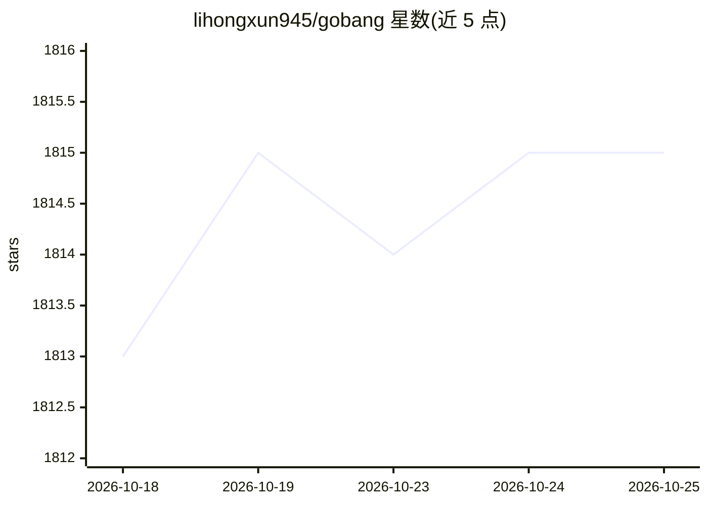

# lihongxun945/gobang

⭐ 1,815 · JavaScript · 推送 2026-09-17 · [GitHub](https://github.com/lihongxun945/gobang) · [官网](https://gobang2.light7.cn/) · 个人维护 · 中文 README

**浏览器本地运行的五子棋 AI（极小极大搜索，非神经网络）**

纯前端 JavaScript 实现的五子棋 AI 与对弈页面，核心为极小化极大搜索加 Alpha-Beta 剪枝、启发式评估、迭代加深、Zobrist 缓存、算杀等优化，不使用神经网络或强化学习。AI 在浏览器本地执行，页面打开后无需联网；难度对应搜索深度。附带系列教程博客、单元测试、AI 棋力评测（对局交换先手、Elo 估计与置信区间）与战术题库工具。本地开发需 Node 与 NPM。

## 筛选速览

| 维度 | 判定 | 备注 |
|---|---|---|
| AI 角色 | `ai-native` | 本体是模型或模型工具 |
| 许可风险 | `none` | — |
| 部署形态 | `library` | 以包/库形式分发 |
| 模型依赖 | — | README 未给出锁定关系 |
| 硬件要求 | — | 无带数字的原话,不猜 |
| 安装摩擦 | `low` | 无编译、无系统依赖或容器化 |
| 成熟度 | `idea` | |

## 能力要点

- 极小化极大+Alpha-Beta 剪枝等经典算法，不依赖神经网络
- AI 完全在浏览器本地执行，页面加载后可离线对弈
- 内置棋力评测工具（交换先手对局、Elo 估计与置信区间）与战术题库
- 提供九篇系列教程讲解算法实现

## 适用场景

- 在网页上与本地 AI 下五子棋
- 学习博弈搜索算法的实现（含配套教程）
- 对 AI 引擎改动做棋力回归评测

## 场景标签

`模型评测` `教程课程` · 领域:评测与运维

## 证据(README 行号)

> L9: 极小化极大算法的五子棋AI实现。 扫描上方二维码，或者打开此页面可以直接体验 https://gobang2.light7.cn/ 如果 `http` 协议无法打开，可以用这个http的链接 http://gobang2.light
> L17: - A：参考后文中我的博客。基本原理是极小化极大搜索算法，做了一些常见的性能优化。没有用到神经网络、强化学习之类的机器学习算法。

## 星数曲线

2026-10-18 1,813 → 2026-10-25 1,815（+2）

---
*卡片 v1 · prompt 1.4 · 生成 2026-10-21 · 置信度 high · 依据 README sha `3e6408e99d9a` · [字段定义](../../DATASET.md)*
