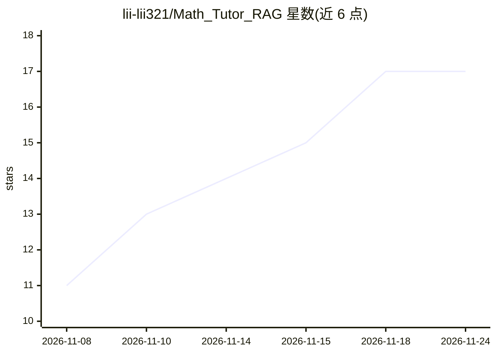

# lii-lii321/Math_Tutor_RAG

⭐ 17 · Python · MIT · 推送 2026-11-22 · [GitHub](https://github.com/lii-lii321/Math_Tutor_RAG) · 个人维护 · 中文 README

**面向师生的数学错题本应用：拍照AI解析+RAG相似题+SM-2复习**

Streamlit + FastAPI 构建的智能错题本 Web 应用：上传错题照片后由视觉大模型输出结构化解析（考点/分步讲解/答案/难度/易错原因），经 SymPy 三态验证后写入 ChromaDB 向量库，支持关键词+向量混合检索的「举一反三」相似题召回、语义搜索、SM-2 间隔重复复习、掌握度画像与教师端学生总览。AI 提供商抽象层可切换 SiliconFlow/通义千问/智谱/DeepSeek/OpenAI/Ollama/Gemini，无 Key 时进入演示模式。提供 Docker Compose 一键部署与 MCP Server 接入 Claude Desktop/Cursor。

## 筛选速览

| 维度 | 判定 | 备注 |
|---|---|---|
| AI 角色 | `ai-native` | 本体是模型或模型工具 |
| 许可风险 | `permissive` | MIT |
| 部署形态 | `self-host` | docker 或自建部署 |
| 模型依赖 | local-ok | 支持本地模型 |
| 硬件要求 | — | 无带数字的原话,不猜 |
| 安装摩擦 | `low` | 无编译、无系统依赖或容器化 |
| 成熟度 | — | 结构信号不足 |

## 能力要点

- 视觉大模型拍照录题，Pydantic Schema 约束的结构化解析 + SymPy 数学答案三态验证
- ChromaDB 向量库 + 混合检索管线（关键词+向量 → RRF 融合 → 可选重排）
- SM-2 间隔重复复习与掌握度引擎（复习日志时间加权）
- 统一 Provider 抽象对接 7 家模型服务，无 Key 自动演示模式

## 适用场景

- 学生拍照录入数学错题并按遗忘曲线自动安排复习
- 通过语义搜索与「举一反三」召回相似历史错题
- 教师查看全班学生错题分布与薄弱知识点总览
- 经 MCP Server 在 Claude Desktop/Cursor 中用自然语言操作错题本

## 场景标签

`RAG` `语义搜索` · 领域:知识与检索

## 证据(README 行号)

> L3: > **30 秒电梯版**：MathMaster Edu 是一个把「拍照录题 → AI 结构化解析 → 数学验证 → 向量检索 → 掌握度画像 → 间隔重复复习」串成完整闭环的智能错题本，面向数学教师与学生的真实教学场景。它解决的是
> L21: |📸 **AI 拍照录题**|上传手写作业/试卷照片，视觉大模型识别题目并输出**结构化解析**（考点、分步讲解、答案、难度、易错原因、变式题），基于 Pydantic Schema 约束输出并稳健解析|
> L146: 1. **AI 录题** — 上传错题照片 → 获得考点分析 / 分步讲解 / 答案 / 难度 / 易错原因 / 变式练习 → 自动归档并写入向量库 → 展示「举一反三」相似历史错题。

## 星数曲线

2026-11-08 11 → 2026-11-24 17（+6）

---
*卡片 v1 · prompt 1.4 · 生成 2026-11-18 · 置信度 mid · 依据 README sha `d5f46e22e2fa` · [字段定义](../../DATASET.md)*
