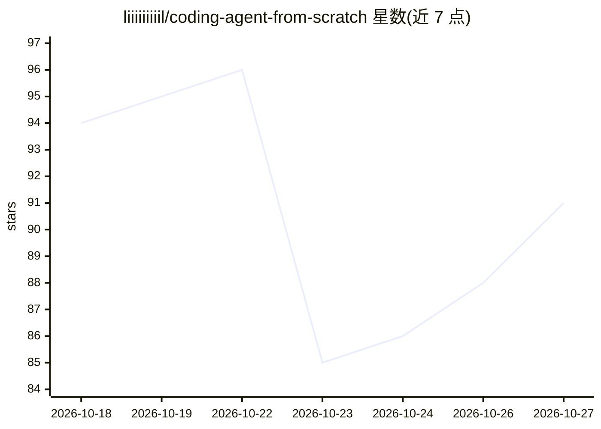

# liiiiiiiiil/coding-agent-from-scratch

⭐ 91 · Python · MIT · 推送 2026-10-08 · [GitHub](https://github.com/liiiiiiiiil/coding-agent-from-scratch) · 个人维护 · 中文 README

**教程：用纯 Python 从零逐步搭建 AI 编程 Agent**

按 Git tag 与能力阶段组织的教程项目，从最简 agent loop 开始逐步实现工具调用、权限闸门、上下文压缩、后台进程、会话持久化、子代理委派、MCP 接入与任务评测，共 53 课。核心只用 Python 标准库，配置兼容 OpenAI Chat Completions 协议的模型服务后可运行，每课源码、diff 与设计取舍可追溯。面向想理解 LLM agent 运行原理的开发者，同时产出可运行的 mini_agent。

## 筛选速览

| 维度 | 判定 | 备注 |
|---|---|---|
| AI 角色 | `ai-knowledge` | 知识聚合/清单类 |
| 许可风险 | `permissive` | MIT |
| 部署形态 | `library` | 以包/库形式分发 |
| 模型依赖 | — | README 未给出锁定关系 |
| 硬件要求 | — | 无带数字的原话,不猜 |
| 安装摩擦 | `low` | 无编译、无系统依赖或容器化 |
| 成熟度 | — | 结构信号不足 |

## 能力要点

- 53 课分阶段构建：agent loop → 工具/权限 → 上下文 → 可靠执行 → 子代理 → MCP → 评测
- 核心只用 Python 标准库，外围交互为可选依赖
- 支持多 provider、Anthropic 协议与 MCP 配置
- 含独立评测链路与回归比较（v0.50–v0.53）

## 适用场景

- 跟随课程理解 AI 编程 Agent 的工作原理
- 按 Git tag 追溯每课源码与设计取舍
- 在兼容 OpenAI 协议的模型服务上运行 mini_agent 执行编码任务

## 场景标签

`教程课程` `编码 Agent` · 领域:编码与开发

## 证据(README 行号)

> L3: ### 逐步生长的编程 Agent：使用 Python 从零开始构建一个能干活的 AI Agent
> L11: 适合想用 Python 标准库理解 LLM agent 如何运行的开发者。每课聚焦一个版本相对上一版新增的核心概念，源码、diff 和设计取舍都可追溯。

## 星数曲线

2026-10-18 94 → 2026-10-27 91（-3）

---
*卡片 v1 · prompt 1.4 · 生成 2026-10-24 · 置信度 high · 依据 README sha `2519b343a8c9` · [字段定义](../../DATASET.md)*
