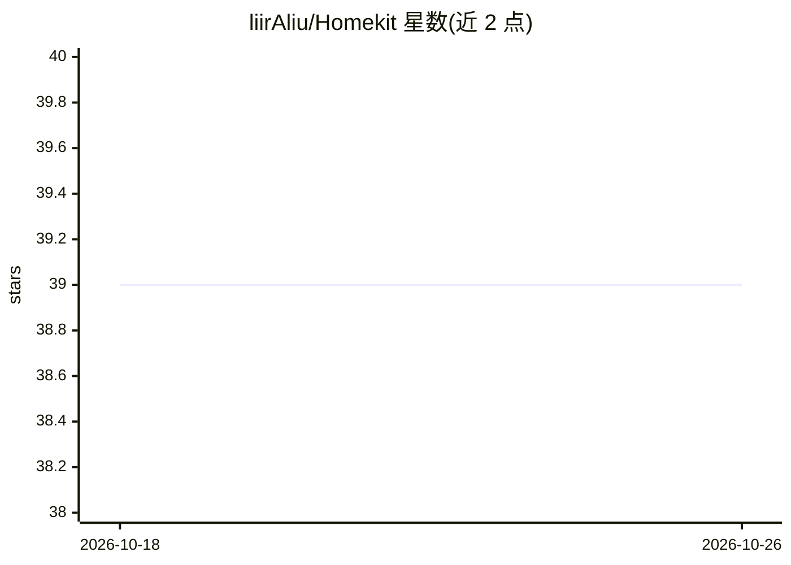

# liirAliu/Homekit

⭐ 39 · TypeScript · MIT · 推送 2026-10-05 · [GitHub](https://github.com/liirAliu/Homekit) · [官网](https://homekit.builders) · 个人维护

**让 AI agent 通过 MCP 直接控制 Apple Home 设备的桥接工具**

包含四个 npm 包：homekit-cli（终端操作 Apple Home）、homekit-mcp（提供 8 个工具的 MCP 服务器）、@homekit/core（共享桥接与认证）及 @openclaw/homekit 插件。AI agent 可经 MCP 调用工具列出/读写配件状态、激活与创建场景、列出并触发自动化；CLI 另有场景导入导出、多 Home 切换、JSON 输出等命令。要求 macOS 13+、Node.js 18、Apple Home 已配置，且需配套 macOS App 完成首次授权。支持 Claude Desktop、Cursor、Windsurf 及任意 MCP 客户端。

## 筛选速览

| 维度 | 判定 | 备注 |
|---|---|---|
| AI 角色 | `ai-ecosystem` | LLM/agent 周边工具 |
| 许可风险 | `permissive` | MIT |
| 部署形态 | `library` | 以包/库形式分发 |
| 模型依赖 | — | README 未给出锁定关系 |
| 硬件要求 | — | 无带数字的原话,不猜 |
| 安装摩擦 | `low` | 无编译、无系统依赖或容器化 |
| 成熟度 | — | 结构信号不足 |

## 能力要点

- MCP 服务器提供 8 个工具（配件读写、场景、自动化）
- CLI 覆盖 16 条命令，含场景导入/导出与 --json 输出
- 兼容 Claude Desktop、Cursor、Windsurf 及任意 stdio MCP 客户端
- 配套 macOS App 完成系统级 Home 授权

## 适用场景

- 用自然语言让 Claude 等 agent 开关灯、锁门、读取传感器
- 在终端直接管理和批量操作 HomeKit 配件与场景
- 把家庭设备暴露为 agent 可调用的结构化工具

## 场景标签

 · 领域:智能家居/IoT 桥接

## 证据(README 行号)

> L35: It exposes your entire Apple Home — every light, lock, thermostat, sensor, scene, and automation — as structured to
> L55: |`homekit-mcp`|MCP server — 8 tools for AI agents|npm|

## 星数曲线

2026-10-18 39 → 2026-10-26 39（+0）

---
*卡片 v1 · prompt 1.4 · 生成 2026-10-25 · 置信度 high · 依据 README sha `aab90810bafc` · [字段定义](../../DATASET.md)*
