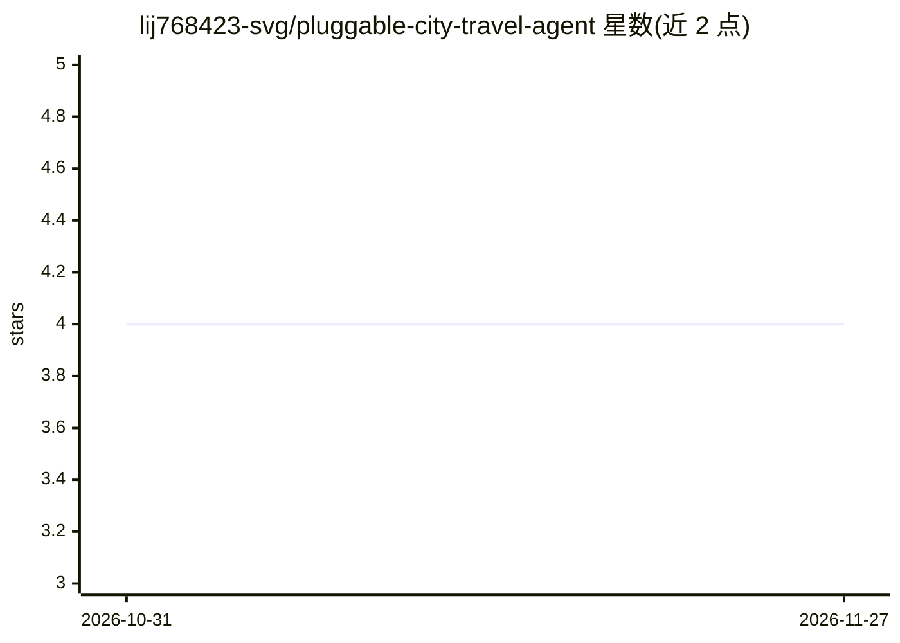

# lij768423-svg/pluggable-city-travel-agent

⭐ 4 · Python · MIT · 推送 2026-11-26 · [GitHub](https://github.com/lij768423-svg/pluggable-city-travel-agent) · [官网](https://melancholy.live/) · 个人维护 · 中文 README

**面向自由行用户的大模型旅行行程规划 Agent（Web + MCP）**

一套规划代码服务多座城市的行程规划系统：Web 端支持问卷或一句话描述需求，服务端由模型理解需求并选点，LangGraph 编排规划节点，OR-Tools 负责排程，附带规则校验与地图展示。新城市通过 onboard_city.py 一条命令接入，自动下载 ChinaTravel 数据、生成标签并拟合交通标定；已接入 10 座城市。另提供 MCP 服务（9 个工具），由 Claude、Codex 等聊天 AI 选点、服务端排程校验。作者声明为研究与原型项目，路线可行性需自行核验。

## 筛选速览

| 维度 | 判定 | 备注 |
|---|---|---|
| AI 角色 | `ai-native` | 本体是模型或模型工具 |
| 许可风险 | `permissive` | MIT |
| 部署形态 | `None` |  |
| 模型依赖 | — | README 未给出锁定关系 |
| 硬件要求 | — | 无带数字的原话,不猜 |
| 安装摩擦 | `low` | 无编译、无系统依赖或容器化 |
| 成熟度 | `idea` | |

## 能力要点

- 一条命令接入新城市：自动完成取数、标签生成、交通标定、评测门槛检查
- 双入口：Web 端模型选点 + MCP 服务由聊天 AI 选点、服务端排程
- OR-Tools 排程与规则校验：景区合并游览、长堤进出分离、冲突提示与单日重排
- 行程可预览、修改、撤销，按账号保存历史

## 适用场景

- 规划北京、杭州等 10 座已接入城市的多日自由行行程
- 用一句话描述出行需求并逐项确认后生成行程
- 在 Claude 等聊天 AI 中通过 MCP 工具生成与查询行程
- 为其他城市按同格式数据接入新的可插拔城市配置

## 场景标签

 · 领域:旅游/行程规划

## 证据(README 行号)

> L1: # 行记 · 可插拔城市旅行规划 Agent（Web + MCP）
> L7: - **Web 端**：问卷、地图和行程页，由服务端模型理解需求并选点。
> L8: - **MCP 服务**：Claude、Codex 等聊天 AI 通过 MCP 工具调用。由聊天 AI 自己选点，服务端不调用语言模型。

## 星数曲线

2026-10-31 4 → 2026-11-27 4（+0）

---
*卡片 v1 · prompt 1.4 · 生成 2026-11-21 · 置信度 high · 依据 README sha `b80bc11ed46e` · [字段定义](../../DATASET.md)*
