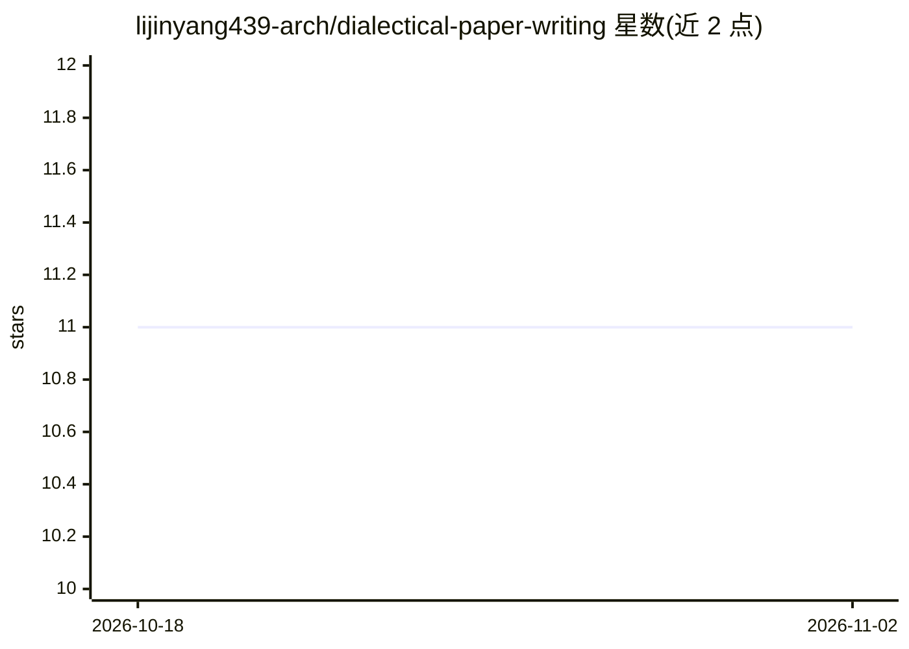

# lijinyang439-arch/dialectical-paper-writing

⭐ 11 · Python · MIT · 推送 2026-08-17 · [GitHub](https://github.com/lijinyang439-arch/dialectical-paper-writing) · 个人维护 · 中文 README

**Codex 学术写作技能：诊断论文论证断裂点并重构论证链**

面向 OpenAI Codex 的 Skill（技能包），用于学术论文写作、研究推理诊断、实验设计与同行评审模拟。核心机制：以“主张–证据关系”为工作单元，通过 GROUND/EXPLAIN/Discriminate 等六个环节定位论证断裂处，再按科学功能重构 Introduction 至 Discussion 各章节；每条命题用溯源（R/U/S/A）与证据状态（recorded/verified/inferred/untested）两套独立账本跟踪，区分来源与验证状态；实验设计要求区分竞争解释的最小判别性测试。支持中英双向翻译（命题/范围/术语/LaTeX 级）。安装方式为 git clone 后复制到 Codex skills 目录。

## 筛选速览

| 维度 | 判定 | 备注 |
|---|---|---|
| AI 角色 | `ai-native` | 本体是模型或模型工具 |
| 许可风险 | `permissive` | MIT |
| 部署形态 | `None` |  |
| 模型依赖 | — | README 未给出锁定关系 |
| 硬件要求 | — | 无带数字的原话,不猜 |
| 安装摩擦 | `low` | 无编译、无系统依赖或容器化 |
| 成熟度 | — | 结构信号不足 |

## 能力要点

- 以主张–证据关系为单元诊断研究逻辑，六环节两决策门一反馈循环
- 溯源标签（R/U/S/A）与证据状态（recorded/untested 等）双账本跟踪
- 按科学功能重构全文各章节而非逐句改写
- 迭代同行评审直到论证收敛或证据缺失成为阻塞项

## 适用场景

- 投稿前让 AI 诊断论文论证链条的断裂点
- 把研究主张转化为区分竞争解释的实验设计
- 中英稿件的命题级双向翻译与回检
- 按审稿意见分类修改并起草证据受限的回复

## 场景标签

`AI 写作` `科研工具` · 领域:内容生成

## 证据(README 行号)

> L5:  A Codex Skill for academic writing, research reasoning, experiment design, and peer review.
> L20: - **Diagnoses research logic** across the question, mechanism, method, evidence, and conclusion.

## 星数曲线

2026-10-18 11 → 2026-11-02 11（+0）

---
*卡片 v1 · prompt 1.4 · 生成 2026-11-02 · 置信度 high · 依据 README sha `2742edc5cd90` · [字段定义](../../DATASET.md)*
