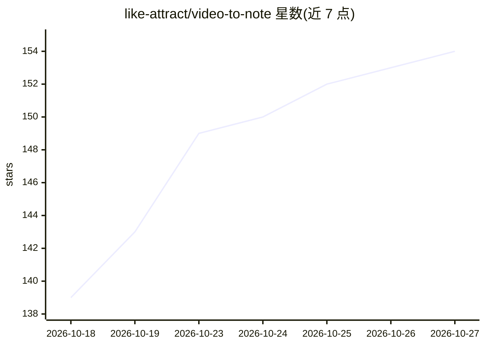

# like-attract/video-to-note

⭐ 154 · Python · MIT · 推送 2026-10-18 · [GitHub](https://github.com/like-attract/video-to-note) · 个人维护 · 中文 README

**本地优先的视频转 Markdown 笔记工具，支持 B站/抖音/本地视频**

VideoToNo 是把视频变成带时间轴 Markdown 笔记的本地服务：输入 B 站、抖音、YouTube 链接或本地文件，优先读取平台字幕（含登录后的 B 站 AI 字幕），无字幕时用 faster-whisper/paraformer 离线转写，再由用户选择的 LLM 生成笔记；也支持仅转录字幕（全程不调大模型、无需 API Key）。提供 Windows 便携版、源码运行、MCP 服务（8 个工具）与 Agent Skill 四种接入方式；媒体处理在本机完成，服务默认只监听 127.0.0.1。限制：非 Windows 平台 API Key 明文保存；重启后运行中任务标记失败。

## 筛选速览

| 维度 | 判定 | 备注 |
|---|---|---|
| AI 角色 | `ai-native` | 本体是模型或模型工具 |
| 许可风险 | `permissive` | MIT |
| 部署形态 | `desktop` | 安装包/桌面程序 |
| 模型依赖 | locked-api |  |
| 硬件要求 | — | 无带数字的原话,不猜 |
| 安装摩擦 | `medium` | 含编译或系统依赖之一 |
| 成熟度 | — | 结构信号不足 |

## 能力要点

- 平台字幕优先 + faster-whisper/paraformer 本地离线转写，保留真实时间轴
- 仅转录模式全程不调大模型、无需 API Key
- 内置 MCP 服务（summarize_video/transcribe_video 等 8 个工具）与 Agent Skill
- B 站深度适配：AI 字幕、扫码登录、412 风控自动回退开放接口

## 适用场景

- 把 B 站/抖音课程视频整理成可回看的 Markdown 笔记
- 只取带时间轴的字幕稿，自己或让 agent 整理内容
- 通过 Cherry Studio、Codex 等 MCP 客户端一句话取转录或生成笔记
- 让 Claude Code 等编码 agent 借助技能脚本直接生成视频笔记

## 场景标签

`语音识别` `AI 写作` · 领域:内容生成

## 证据(README 行号)

> L15: VideoToNo 把「视频 → 结构化笔记」这条链路做成了一个**本地优先**的服务：输入 B 站、抖音、YouTube 链接或本地视频，优先读取平台字幕、B 站 AI 字幕，无字幕时用本机模型离线转写（中文首选 parafor
> L78: - 🧾 **真实时间轴**：保留字幕或 Whisper 分段的起止时间，不让模型凭空猜时间点。

## 星数曲线

2026-10-18 139 → 2026-10-27 154（+15）

---
*卡片 v1 · prompt 1.4 · 生成 2026-10-23 · 置信度 mid · 依据 README sha `200e02d73be5` · [字段定义](../../DATASET.md)*
