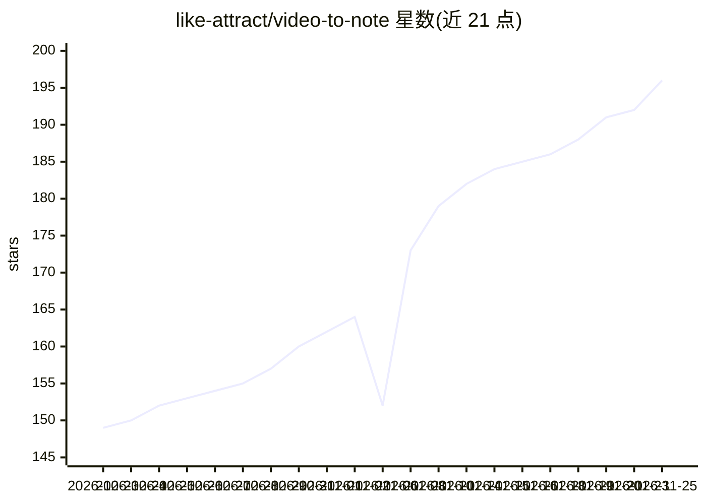

# like-attract/video-to-note

⭐ 196 · Python · MIT · 推送 2026-11-08 · [GitHub](https://github.com/like-attract/video-to-note) · 个人维护 · 中文 README

**本地优先服务：把 B站/抖音/本地视频转成带时间轴的 Markdown 笔记**

VideoToNo 提供「视频 → 结构化笔记」链路：输入 B 站、抖音、YouTube 或本地视频，优先读取平台字幕（含 B 站 AI 字幕），无字幕时用本机模型离线转写（paraformer 或 whisper 系），再由用户配置的大模型生成带时间轴的 Markdown 笔记；也可选「仅转录」模式，不调用大模型。接入方式包括 Windows 便携版桌面应用、内置 MCP 服务（WorkBuddy、Cherry Studio、Codex 等客户端）和 Agent Skill。API Key 与 B 站凭据在本机保存，Windows 上经 DPAPI 加密；服务默认只监听 127.0.0.1。主要面向 Windows + Python 3.11。

## 筛选速览

| 维度 | 判定 | 备注 |
|---|---|---|
| AI 角色 | `ai-native` | 本体是模型或模型工具 |
| 许可风险 | `permissive` | MIT |
| 部署形态 | `desktop` | 安装包/桌面程序 |
| 模型依赖 | locked-api |  |
| 硬件要求 | — | 无带数字的原话,不猜 |
| 安装摩擦 | `medium` | 含编译或系统依赖之一 |
| 成熟度 | — | 结构信号不足 |

## 能力要点

- 平台字幕优先、无字幕时本机离线转写（paraformer-zh / whisper）
- MCP 工具集与 Agent Skill 两种 agent 接入，transcribe_video 不需 API Key
- 长视频分块逐段生成笔记，支持多分 P 与 2GB 本地文件上传
- 导出 Markdown、HTML、JSON、PNG、Word、SRT 等多格式

## 适用场景

- 把 B 站长课视频转成带时间轴的复习笔记
- 给本地 agent 提供视频转文字稿的原料出口
- 无字幕视频离线转写并整理成文

## 场景标签

`语音识别` · 领域:感知与多模态

## 证据(README 行号)

> L15: VideoToNo 把「视频 → 结构化笔记」这条链路做成了一个**本地优先**的服务：输入 B 站、抖音、YouTube 链接或本地视频，优先读取平台字幕、B 站 AI 字幕，无字幕时用本机模型离线转写（中文首选 parafor
> L133: VideoToNo 内置 MCP（Model Context Protocol）服务，可以在 WorkBuddy、Cherry Studio、Codex 等 AI 客户端里直接输入视频链接取字幕稿或生成笔记。**使用前请先启动 

## 星数曲线

2026-10-23 149 → 2026-11-25 196（+47）

---
*卡片 v1 · prompt 1.4 · 生成 2026-11-25 · 置信度 mid · 依据 README sha `451543a56bb0` · [字段定义](../../DATASET.md)*
