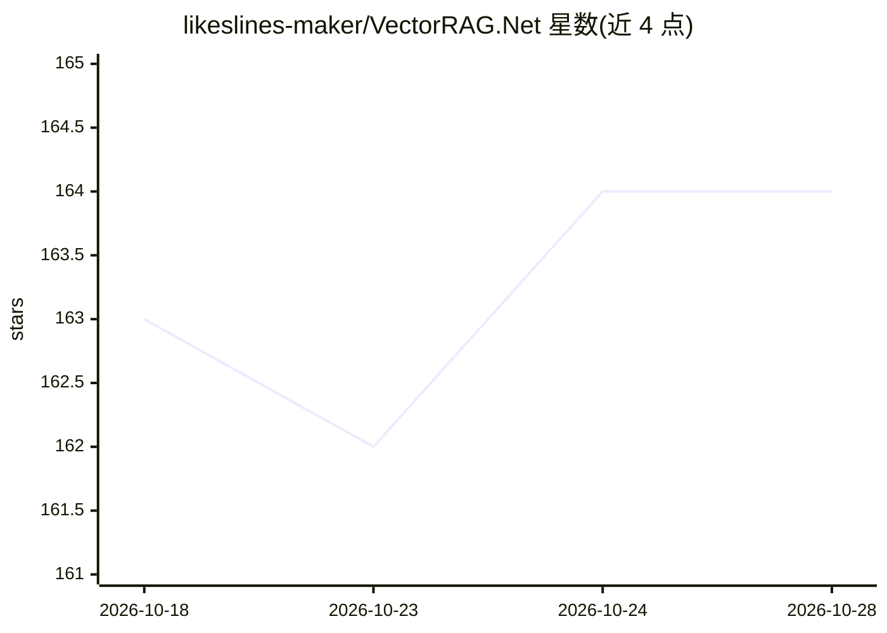

# likeslines-maker/VectorRAG.Net

⭐ 164 · C# · 推送 2026-08-23 · [GitHub](https://github.com/likeslines-maker/VectorRAG.Net) · [官网](https://principium.pro) · 个人维护

**.NET 8 进程内嵌入式向量数据库，面向语义搜索与 RAG**

以 NuGet 包分发的 .NET 8 原生嵌入式向量数据库：进程内运行，无 HTTP、Docker 或外部服务，采用 SIMD 向量搜索与 Random Hyperplane LSH 候选生成加精确重排，支持向量+BM25 混合搜索、自动文档分块、元数据过滤与快照读写，供本地 RAG、内部知识库、离线桌面与边缘场景的开发者使用。需许可证密钥初始化；生产使用要求一次性 $300 的永久商业许可。

## 筛选速览

| 维度 | 判定 | 备注 |
|---|---|---|
| AI 角色 | `ai-ecosystem` | LLM/agent 周边工具 |
| 许可风险 | `none` | — |
| 部署形态 | `None` |  |
| 模型依赖 | — | README 未给出锁定关系 |
| 硬件要求 | — | 无带数字的原话,不猜 |
| 安装摩擦 | `medium` | 含编译或系统依赖之一 |
| 成熟度 | — | 结构信号不足 |

## 能力要点

- 进程内嵌入式架构，无 HTTP/Docker/外部服务
- LSH 候选生成 + 点积/余弦精确重排，SIMD 优化
- 向量 + BM25 混合搜索与元数据过滤
- 快照保存/加载与运行时指标

## 适用场景

- 在 .NET 应用内本地存储嵌入并检索 RAG 上下文
- 为文档与支持门户构建低延迟语义搜索
- 在无外网或禁止外部网络访问的环境运行向量检索

## 场景标签

`向量数据库` · 领域:知识与检索

## 证据(README 行号)

> L3: High-performance embedded vector database for .NET 8.
> L5: VectorRAG.Net is an in-process vector database designed for Retrieval-Augmented Generation (RAG), semantic search, l

## 星数曲线

2026-10-18 163 → 2026-10-28 164（+1）

---
*卡片 v1 · prompt 1.4 · 生成 2026-10-22 · 置信度 high · 依据 README sha `bb474ab87616` · [字段定义](../../DATASET.md)*
