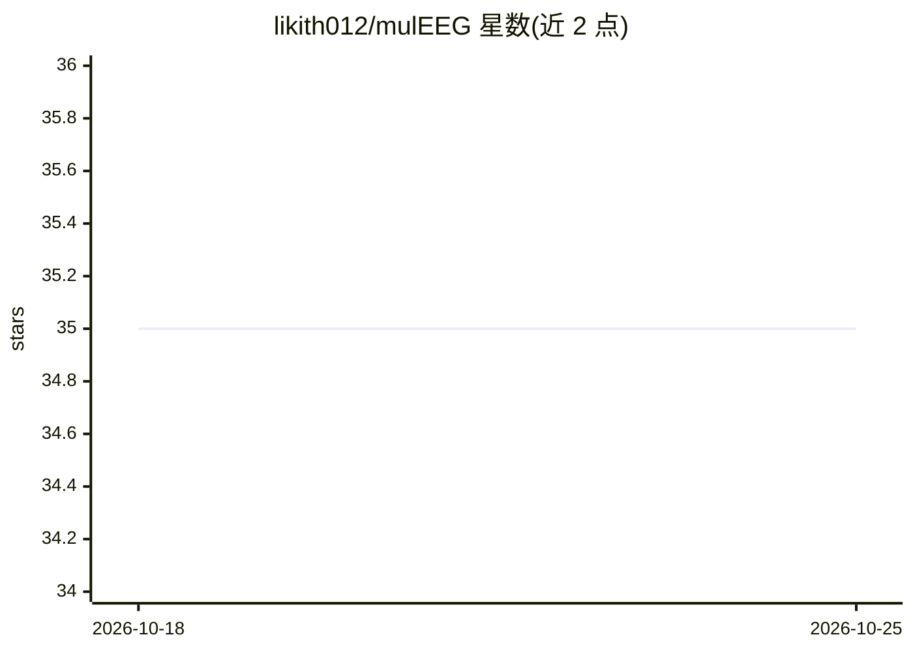

# likith012/mulEEG

⭐ 35 · Python · Apache-2.0 · 推送 2025-10-29 · [GitHub](https://github.com/likith012/mulEEG) · 个人维护

**面向 EEG 睡眠分期的多视角自监督表征学习官方实现**

MICCAI 2022 论文 mulEEG 的官方代码库：提出多视角自监督方法，在无标签 EEG 数据上做无监督表征学习，引入 diverse loss 促进多视角间互补信息，用于睡眠分期迁移学习实验。提供完整预处理流程、数据增强与训练脚本，以及 Sleep-EDF 与 SHHS 数据集上的预训练权重和各基线方法权重。基于 Python 3.7 开发，可通过 requirements.txt 或 Dockerfile 环境搭建，Apache 2.0 许可。

## 筛选速览

| 维度 | 判定 | 备注 |
|---|---|---|
| AI 角色 | `ai-native` | 本体是模型或模型工具 |
| 许可风险 | `permissive` | Apache-2.0 |
| 部署形态 | `self-host` | docker 或自建部署 |
| 模型依赖 | — | README 未给出锁定关系 |
| 硬件要求 | — | 无带数字的原话,不猜 |
| 安装摩擦 | `low` | 无编译、无系统依赖或容器化 |
| 成熟度 | — | 结构信号不足 |

## 能力要点

- 自监督模型在无标签 EEG 数据上预训练
- 提供完整预处理、增强与训练脚本
- 提供各基线与本文方法的预训练权重（Sleep-EDF/SHHS）
- Dockerfile 环境搭建方式

## 适用场景

- 复现 MICCAI 2022 论文的睡眠分期实验结果
- 在自有 EEG 数据上做自监督预训练表征学习
- 下载预训练权重做迁移学习实验

## 场景标签

`模型训练` · 领域:训练与推理

## 证据(README 行号)

> L7: This repostiory contains code, results and dataset links for our MICCAI-2022 paper titled ***mulEEG: A Multi-View Re
> L20: >Modeling effective representations using multiple views that
> L25: - A self-supervised model pre-trained on unlabelled Electroencephalography (EEG) data beating the supervised counte

## 星数曲线

2026-10-18 35 → 2026-10-25 35（+0）

---
*卡片 v1 · prompt 1.4 · 生成 2026-10-25 · 置信度 high · 依据 README sha `0d37c16e48f6` · [字段定义](../../DATASET.md)*
