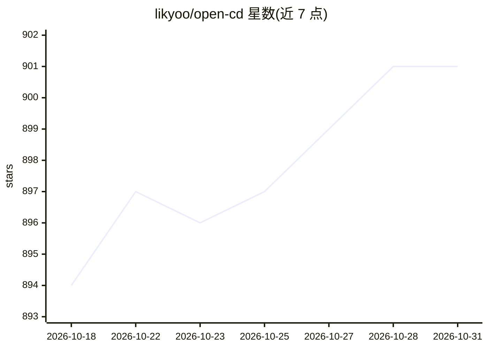

# likyoo/open-cd

⭐ 901 · Python · Apache-2.0 · 推送 2026-06-15 · [GitHub](https://github.com/likyoo/open-cd) · [官网](https://arxiv.org/abs/2407.15317) · 组织维护

**遥感变化检测开源工具箱：训练/测试/推理多模型**

基于 OpenMMLab 等开源视觉工具构建的遥感变化检测工具箱，面向科研与开发者。收录 FC-EF、ChangeFormer、Changer、BAN、MTKD 等 19 种变化检测模型，支持 LEVIR-CD、WHU-CD、SECOND 等 11 个数据集，提供训练、测试与推理 API。安装依赖 OpenMMLab 工具链（openmim/mmengine 等），从源码 git clone 后 pip install -v -e 使用，另提供 Colab 教程。技术报告被 ACMMM 2025 接收，采用 Apache 2.0 许可证。

## 筛选速览

| 维度 | 判定 | 备注 |
|---|---|---|
| AI 角色 | `ai-native` | 本体是模型或模型工具 |
| 许可风险 | `permissive` | Apache-2.0 |
| 部署形态 | `library` | 以包/库形式分发 |
| 模型依赖 | — | README 未给出锁定关系 |
| 硬件要求 | — | 无带数字的原话,不猜 |
| 安装摩擦 | `low` | 无编译、无系统依赖或容器化 |
| 成熟度 | — | 结构信号不足 |

## 能力要点

- 收录 19 种变化检测模型（FC-EF、Changer、BAN、MTKD 等）
- 支持 11 个变化检测数据集（LEVIR-CD、WHU-CD、SECOND 等）
- 提供训练/测试脚本与推理 API
- 技术报告被 ACMMM 2025 接收

## 适用场景

- 在 LEVIR-CD 等遥感数据集上训练变化检测模型
- 复现与对比多种变化检测方法
- 对双时相遥感影像做变化区域推理输出

## 场景标签

`目标检测` · 领域:感知与多模态

## 证据(README 行号)

> L4: Open-CD is an open source change detection toolbox based on a series of open source general vision task tools.
> L29: Supported change detection model:

## 星数曲线

2026-10-18 894 → 2026-10-31 901（+7）

---
*卡片 v1 · prompt 1.4 · 生成 2026-10-21 · 置信度 high · 依据 README sha `f339c2a23199` · [字段定义](../../DATASET.md)*
