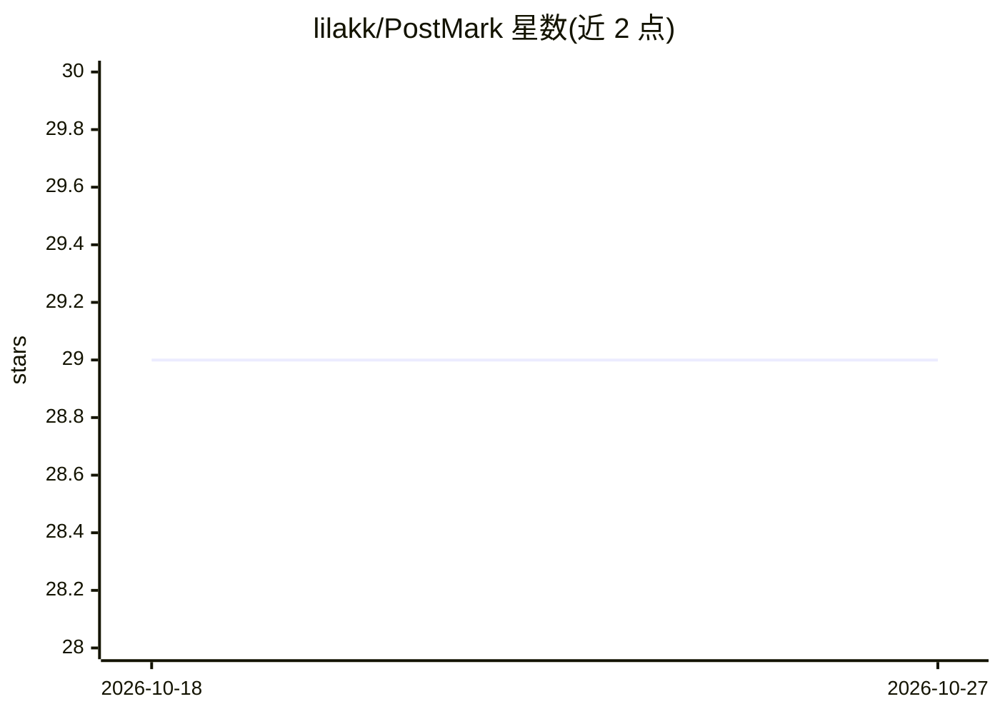

# lilakk/PostMark

⭐ 29 · Python · 推送 2026-10-15 · [GitHub](https://github.com/lilakk/PostMark) · [官网](https://arxiv.org/abs/2406.14517) · 组织维护

**面向黑盒 LLM 的后处理文本水印方法及论文复现仓库**

PostMark 是一种无需访问模型 logits 的后处理（post-hoc）水印方法，可为 GPT-4 等黑盒 LLM 的输出注入水印并进行检测。仓库提供论文中报告的标注、输出数据与复现脚本：通过 python 脚本运行水印注入（watermark.py）与检测（detect.py），复现 TPR 与人工评估数字需从 Hugging Face 下载数据文件并配置 OpenAI key。限制：论文实验依赖 OpenAI 与 together.ai API，运行代码当时仍在清理中（承诺 2024 年 7 月中前上传）。

## 筛选速览

| 维度 | 判定 | 备注 |
|---|---|---|
| AI 角色 | `ai-native` | 本体是模型或模型工具 |
| 许可风险 | `none` | — |
| 部署形态 | `library` | 以包/库形式分发 |
| 模型依赖 | — | README 未给出锁定关系 |
| 硬件要求 | — | 无带数字的原话,不猜 |
| 安装摩擦 | `low` | 无编译、无系统依赖或容器化 |
| 成熟度 | `idea` | |

## 能力要点

- 不依赖模型 logits，可对黑盒 LLM 输出加水印
- 提供 watermark.py 注入与 detect.py 检测脚本
- 附论文各表格 TPR 与人工评估的复现脚本及数据
- 支持 GPT-4 为基底 LLM、text-embedding-3-large 为嵌入器、GPT-4o 为插入器

## 适用场景

- 给黑盒 LLM 生成的文本注入可检测水印
- 复现论文中的 TPR 与评估数字
- 研究水印在改写攻击下的鲁棒性

## 场景标签

 · 领域:NLP/LLM 安全

## 证据(README 行号)

> L5: PostMark is a post-hoc watermarking method that operates without access to model logits, enabling it to watermark ou
> L43: The command below will run PostMark with GPT-4 as the base LLM, OpenAI text-embedding-3-large as the embedder, and 

## 星数曲线

2026-10-18 29 → 2026-10-27 29（+0）

---
*卡片 v1 · prompt 1.4 · 生成 2026-10-26 · 置信度 mid · 依据 README sha `b03a5cb5f64e` · [字段定义](../../DATASET.md)*
