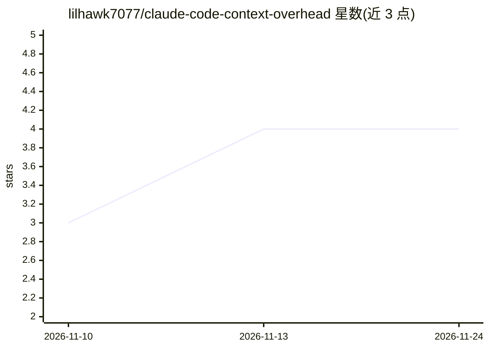

# lilhawk7077/claude-code-context-overhead

⭐ — · [GitHub]() · 个人维护 · 中文 README

**教程文章：拆解 Claude Code 每轮上下文占用并给出精简方法**

这是一篇基于单次 /context all 测量的教程式分析：作者在 Mac 上测量 Claude Code 新会话首条提示前的 39.6k token 占用，逐项拆分为记忆文件、技能列表、自定义 agent、系统提示与工具等类别，解释 prompt caching 下占用与计费的差异，并给出六条精简步骤（去重规则文件、路径限定加载、缩减 CLAUDE.md、整理技能与 agent 描述等）。面向使用 Claude Code 并希望理解与降低固定上下文占用的开发者。文中披露作者另开发了一款付费 macOS 应用 Vexilo Code，并强调数字仅来自单机测量。

## 筛选速览

| 维度 | 判定 | 备注 |
|---|---|---|
| AI 角色 | `ai-knowledge` | 知识聚合/清单类 |
| 许可风险 | `none` | — |
| 部署形态 | `None` |  |
| 模型依赖 | — | README 未给出锁定关系 |
| 硬件要求 | — | 无带数字的原话,不猜 |
| 安装摩擦 | `low` | 无编译、无系统依赖或容器化 |
| 成熟度 | — | 结构信号不足 |

## 能力要点

- /context all 输出的 39.6k token 分类明细表
- 解释 deferred 工具不计入初始占用及自动压缩缓冲的构成
- 六条精简步骤：合并规则、paths 限定加载、削减技能与 agent 描述
- 介绍 /skill-doctor 与 /doctor prompt-audit 等内置诊断命令

## 适用场景

- 测量自己 Claude Code 会话的固定上下文占用
- 清理堆积的 CLAUDE.md、规则与技能以降低每轮开销
- 判断 MCP 工具定义是否真的占用上下文

## 场景标签

`教程课程` · 领域:学习与行业

## 证据(README 行号)

> L1: # My Claude Code loads 39.6k tokens before I type anything — here's where they go
> L11: This post walks through what each bucket in that number is, how to measure your own, and what I'm trimming. One mac

## 星数曲线

2026-11-10 3 → 2026-11-24 4（+1）

---
*卡片 v1 · prompt 1.4 · 生成 2026-11-21 · 置信度 high · 依据 README sha `2c289bb4982a` · [字段定义](../../DATASET.md)*
