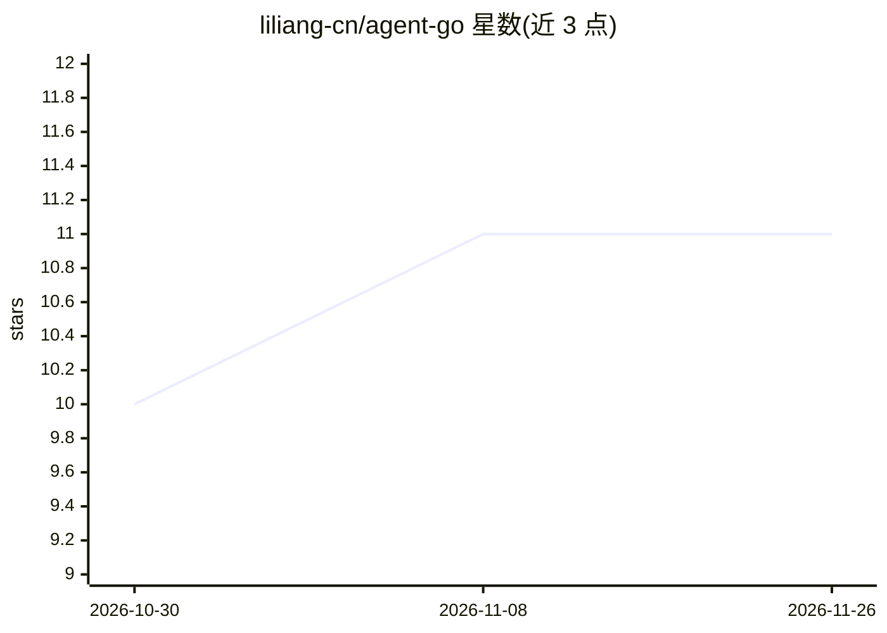

# liliang-cn/agent-go

⭐ 11 · Go · MIT · 推送 2026-11-23 · [GitHub](https://github.com/liliang-cn/agent-go) · [官网](https://liliang-cn.github.io/agent-go/) · 个人维护 · 中文 README

**Go 开发者的 AI Agent SDK：嵌入程序的 agent 循环库**

一个 Go 语言库，实现可嵌入自有程序的 agent 循环：工具调用、记忆、MCP、SKILL.md 技能、会话、检查点、长任务与常驻 agent。通过 Builder 选项装配 LLM、记忆存储、RAG、沙箱、子 agent 与代码模式等组件；provider 接入采用 OpenAI 兼容端点，并可经 pool 在多 provider 间负载均衡。无 CLI、无 UI、无 server，仅为库形态。安装要求 Go 1.25+，经 go get 引入 v3 版本。

## 筛选速览

| 维度 | 判定 | 备注 |
|---|---|---|
| AI 角色 | `ai-ecosystem` | LLM/agent 周边工具 |
| 许可风险 | `permissive` | MIT |
| 部署形态 | `None` |  |
| 模型依赖 | local-ok | 支持本地模型 |
| 硬件要求 | — | 无带数字的原话,不猜 |
| 安装摩擦 | `low` | 无编译、无系统依赖或容器化 |
| 成熟度 | — | 结构信号不足 |

## 能力要点

- 嵌入式的 agent 循环：Ask/Chat/Stream/Run/RunStream/RunSegments 多级调用接口
- 多记忆后端可插拔（cortex、mem0、qdrant、weaviate 等）与图记忆
- OpenAI 兼容多 provider 接入及 pool 轮询负载均衡
- 支持 MCP 工具、SKILL.md 技能、子 agent 与沙箱内代码模式

## 适用场景

- 在 Go 服务中嵌入具备工具调用与记忆的 agent
- 多 provider 负载均衡并按 token 统计用量
- 为长任务配置检查点、恢复与常驻唤醒的 agent

## 场景标签

`Agent 框架` · 领域:Agent 开发

## 证据(README 行号)

> L9: A Go library for running an agent loop: tools, memory, MCP, skills, sessions, checkpoints, lints, long runs. No CLI,
> L86: Any OpenAI-compatible endpoint: OpenAI, DeepSeek, Ollama, vLLM, DashScope/Qwen, gateways.

## 星数曲线

2026-10-30 10 → 2026-11-26 11（+1）

---
*卡片 v1 · prompt 1.4 · 生成 2026-11-18 · 置信度 high · 依据 README sha `b11be396921d` · [字段定义](../../DATASET.md)*
