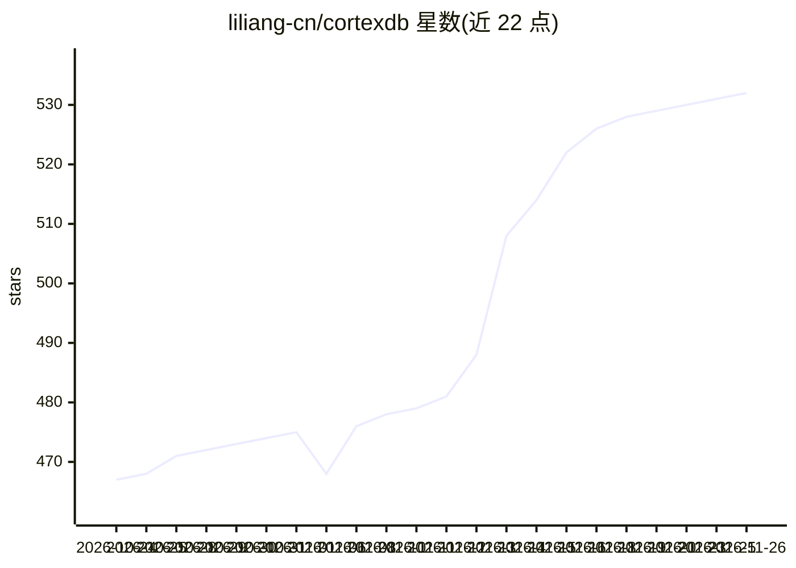

# liliang-cn/cortexdb

⭐ 532 · Go · MIT · 推送 2026-11-25 · [GitHub](https://github.com/liliang-cn/cortexdb) · [官网](https://liliang-cn.github.io/cortexdb/) · 个人维护 · 中文 README

**给编码 Agent 的本地记忆库：知识图谱存偏好决策，多机共享**

用 Go 编写的本地优先 Agent 记忆存储，数据落在一个 SQLite 文件。工作时自动捕获偏好、决策与项目事实，在下一次提示前召回；支持指向同一个 cortexdb-grpc 服务器实现多 Agent、多机器共享。内置真实知识图谱（SPARQL、Cypher、本体、推理、历史），默认无需嵌入模型即可工作，加模型可获得语义检索；提供 Web 实时视图查看图谱与每次召回。以 Claude Code/Codex/Antigravity 插件、Go 库及 Rust/Python/Node 客户端形态提供。

## 筛选速览

| 维度 | 判定 | 备注 |
|---|---|---|
| AI 角色 | `ai-ecosystem` | LLM/agent 周边工具 |
| 许可风险 | `permissive` | MIT |
| 部署形态 | `None` |  |
| 模型依赖 | — | README 未给出锁定关系 |
| 硬件要求 | — | 无带数字的原话,不猜 |
| 安装摩擦 | `low` | 无编译、无系统依赖或容器化 |
| 成熟度 | — | 结构信号不足 |

## 能力要点

- 单 SQLite 文件本地存储，多 Agent 通过 gRPC 服务器共享同一记忆
- 知识图谱支持 SPARQL、Cypher、本体约束、推理与历史
- 默认无需嵌入模型，可选模型启用语义检索
- 提供桌面/手机 Web 实时视图查看图谱与召回记录

## 适用场景

- 让 Claude Code 与 Codex 在不同机器间共享项目上下文
- 为自研 Agent 接入持久化知识与召回能力
- 以 Web 视图检视 Agent 记忆图谱的每次变更

## 场景标签

`Agent 记忆` `知识图谱` · 领域:Agent 开发

## 证据(README 行号)

> L41: - **One brain, many agents.** Point every agent and machine at one `cortexdb-grpc` server and they share it.
> L43: - **No model required.** Works without an embedding model; add one for semantic search.
> L44: - **A real knowledge graph.** SPARQL, Cypher, ontology, inference and history, if you want to go deeper.

## 星数曲线

2026-10-24 467 → 2026-11-26 532（+65）

---
*卡片 v1 · prompt 1.4 · 生成 2026-11-26 · 置信度 high · 依据 README sha `6a484b32e1c9` · [字段定义](../../DATASET.md)*
