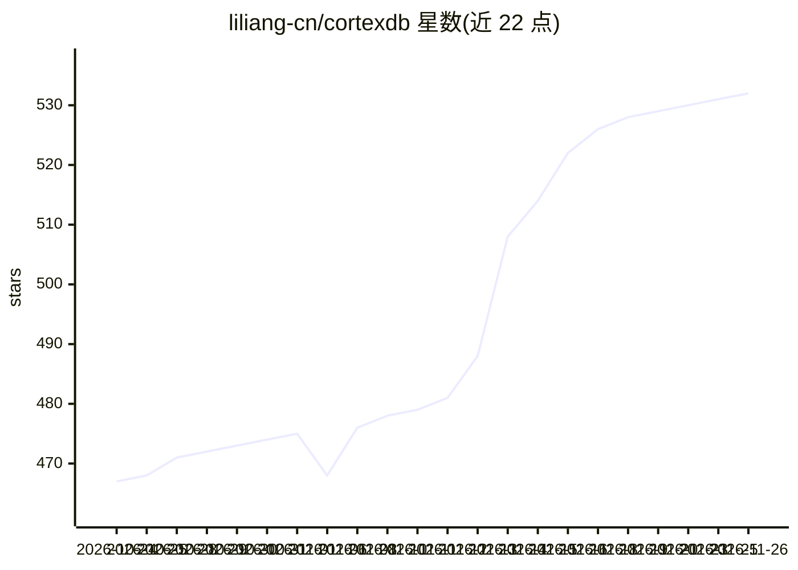

# liliang-cn/cortexdb

⭐ 532 · Go · MIT · 推送 2026-11-25 · [GitHub](https://github.com/liliang-cn/cortexdb) · [官网](https://liliang-cn.github.io/cortexdb/) · 个人维护 · 中文 README

**为编码 agent 提供共享记忆的本地知识图谱库**

用 Go 编写的本地优先 agent 记忆库：将偏好、决策和项目事实存入单个 SQLite 文件，以知识图谱组织，支持 SPARQL、Cypher、本体约束、推理与历史记录。多个 agent 与多台机器可指向同一个 cortexdb-grpc 服务器共享记忆。默认无需嵌入模型即可工作，添加模型后可启用语义检索。通过 Claude Code/Codex 插件市场安装，也提供 Go 库及 Rust、Python、Node 客户端，附带 Web 实时视图展示图谱与召回。

## 筛选速览

| 维度 | 判定 | 备注 |
|---|---|---|
| AI 角色 | `ai-ecosystem` | LLM/agent 周边工具 |
| 许可风险 | `permissive` | MIT |
| 部署形态 | `None` |  |
| 模型依赖 | — | README 未给出锁定关系 |
| 硬件要求 | — | 无带数字的原话,不猜 |
| 安装摩擦 | `low` | 无编译、无系统依赖或容器化 |
| 成熟度 | — | 结构信号不足 |

## 能力要点

- 多个 agent 与机器通过 gRPC 服务器共享同一记忆库
- 数据存储于单个 SQLite 文件，local-first
- 支持 SPARQL/Cypher/本体/推理/历史的知识图谱
- 无需嵌入模型即可运行，可选接入以获得语义搜索

## 适用场景

- 让 Claude Code 与 Codex 共享项目偏好与决策记录
- 在多台机器与后续会话间延续 agent 记忆
- 用 Web 视图查看记忆图谱与召回过程

## 场景标签

`Agent 记忆` `知识图谱` · 领域:Agent 开发

## 证据(README 行号)

> L5: Memory your coding agents share. Tell Claude Code something once, and Codex, your other machines and next week's ses
> L35: - **One brain, many agents.** Point every agent and machine at one `cortexdb-grpc` server and they share it.
> L37: - **No model required.** Works without an embedding model; add one for semantic search.

## 星数曲线

2026-10-24 467 → 2026-11-26 532（+65）

---
*卡片 v1 · prompt 1.4 · 生成 2026-11-25 · 置信度 high · 依据 README sha `177d4ec71353` · [字段定义](../../DATASET.md)*
