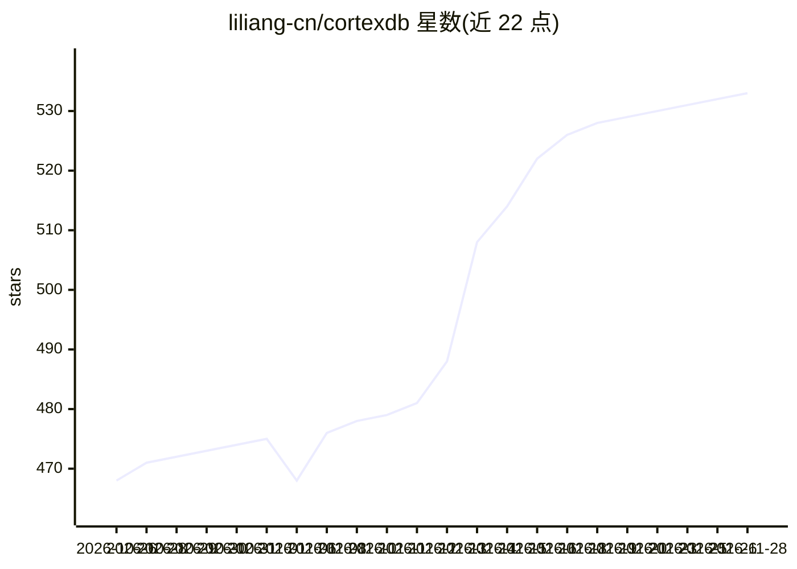

# liliang-cn/cortexdb

⭐ 533 · Go · MIT · 推送 2026-11-27 · [GitHub](https://github.com/liliang-cn/cortexdb) · [官网](https://liliang-cn.github.io/cortexdb/) · 个人维护 · 中文 README

**给编码 agent 共享的本地记忆库：知识图谱+本体约束存于单个 SQLite 文件**

用 Go 编写的本地优先 agent 记忆库，将偏好、决策与项目事实存入单个 SQLite 文件，支持知识图谱（SPARQL/Cypher）、本体约束、推理历史与全文检索，可通过 gRPC 服务器让多台机器上的多个 agent 共享同一份记忆，并提供网页版实时视图查看图谱与召回记录。通过 Claude Code/Codex/Antigravity 插件或 Go 库、CLI 使用；无嵌入模型时按全文方式工作，接入嵌入模型后支持语义检索。

## 筛选速览

| 维度 | 判定 | 备注 |
|---|---|---|
| AI 角色 | `ai-ecosystem` | LLM/agent 周边工具 |
| 许可风险 | `permissive` | MIT |
| 部署形态 | `library` | 以包/库形式分发 |
| 模型依赖 | — | README 未给出锁定关系 |
| 硬件要求 | — | 无带数字的原话,不猜 |
| 安装摩擦 | `low` | 无编译、无系统依赖或容器化 |
| 成熟度 | — | 结构信号不足 |

## 能力要点

- 多 agent/多机器通过一个 cortexdb-grpc 服务器共享记忆
- 知识图谱支持 SPARQL、Cypher、本体与推理历史
- 无嵌入模型也可工作，可选接入模型获得语义检索
- 提供桌面/手机可访问的实时图谱网页视图

## 适用场景

- 让 Claude Code 记住项目偏好，其他 agent 会话可直接复用
- 多台机器上的编码 agent 共享同一份项目记忆
- 通过网页视图查看 agent 记忆图谱与召回记录

## 场景标签

`Agent 记忆` `知识图谱` · 领域:Agent 开发

## 证据(README 行号)

> L5: Memory your coding agents share. Tell Claude Code something once, and Codex, your other machines and next week's ses
> L41: - **One brain, many agents.** Point every agent and machine at one `cortexdb-grpc` server and they share it.
> L43: - **No model required.** Works without an embedding model; add one for semantic search.

## 星数曲线

2026-10-26 468 → 2026-11-28 533（+65）

---
*卡片 v1 · prompt 1.4 · 生成 2026-11-27 · 置信度 high · 依据 README sha `9463dbce6244` · [字段定义](../../DATASET.md)*
