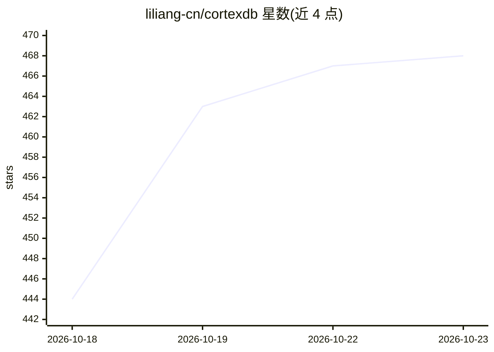

# liliang-cn/cortexdb

⭐ 468 · Go · MIT · 推送 2026-10-22 · [GitHub](https://github.com/liliang-cn/cortexdb) · [官网](https://liliang-cn.github.io/cortexdb/) · 个人维护 · 中文 README

**单 SQLite 文件内的 AI 记忆与知识图库，供 agent 接入**

纯 Go 实现的嵌入式数据库：在单个 SQLite 文件（可选 PostgreSQL+pgvector）中提供向量索引（HNSW/IVF/flat/二值码）、FTS5 全文与图检索、RAG 知识、按作用域划分的 agent 记忆及上下文包；内含 RDF 1.2 知识图，支持 SPARQL、RDFS+OWL 2 RL 推理、SHACL 校验与只读 Cypher。通过 80+ MCP 工具接入 Claude Code、Codex、DeepSeek Harness，也提供 Go 库、Rust/Python/Node 客户端与共享记忆 gRPC 服务器。未设 embedding 端点时以词法模式运行。

## 筛选速览

| 维度 | 判定 | 备注 |
|---|---|---|
| AI 角色 | `ai-ecosystem` | LLM/agent 周边工具 |
| 许可风险 | `permissive` | MIT |
| 部署形态 | `library` | 以包/库形式分发 |
| 模型依赖 | locked-api |  |
| 硬件要求 | — | 无带数字的原话,不猜 |
| 安装摩擦 | `low` | 无编译、无系统依赖或容器化 |
| 成熟度 | — | 结构信号不足 |

## 能力要点

- 单 SQLite 文件承载向量检索、RAG 与 RDF/SPARQL 知识图
- 80+ 工具可进程内调用或经 MCP 供 agent 使用
- 无 embedding 模型时可运行（词法模式）
- cortexdb-grpc 让多 agent/多机共享同一记忆与图

## 适用场景

- 给 Claude Code / Codex 等 coding agent 挂一个持久的项目记忆
- 多台机器上的多个 agent 共享同一知识库与记忆
- 在 Go 应用里嵌入向量+知识图混合检索能力

## 场景标签

`Agent 记忆` `知识图谱` `向量数据库` · 领域:Agent 开发

## 证据(README 行号)

> L5: AI memory and a knowledge graph in one SQLite file. Pure Go, no service to run, works without an embedding model.
> L71: - 80+ tools, in-process or over MCP

## 星数曲线

2026-10-18 444 → 2026-10-23 468（+24）

---
*卡片 v1 · prompt 1.4 · 生成 2026-10-21 · 置信度 mid · 依据 README sha `a42014524ba6` · [字段定义](../../DATASET.md)*
