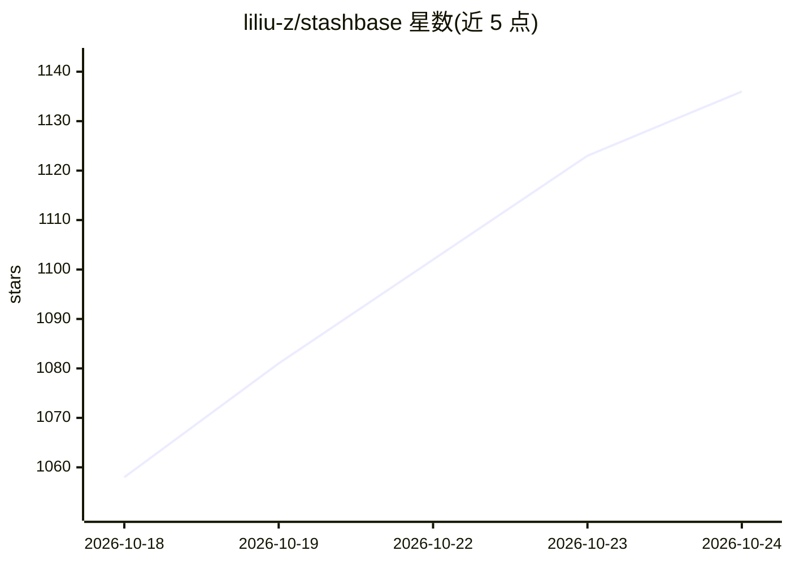

# liliu-z/stashbase

⭐ 1,141 · TypeScript · Apache-2.0 · 推送 2026-10-24 · [GitHub](https://github.com/liliu-z/stashbase) · [官网](https://stashbase.ai) · 个人维护

**本地优先的写作工作区：用自己的资料与 AI agent 共同写作**

基于 Electron 的本地知识库写作应用：文档、PDF、Word 与扫描件保存在本地文件夹，用户在聊天界面中选择 Claude、Codex 或 Antigravity agent，在自有账户下让 agent 起草、修改文档并链接来源；Review 功能逐处显示 agent 的编辑供撤销或保留。内置 Default Agent 走 StashBase 托管网关（经 OpenRouter 到 Claude Haiku 5.5），语义搜索需自带 OpenAI/OpenRouter key。文本提取与 OCR 在本地运行。提供 macOS/Windows/Linux 桌面安装包，也可从源码构建。

## 筛选速览

| 维度 | 判定 | 备注 |
|---|---|---|
| AI 角色 | `ai-native` | 本体是模型或模型工具 |
| 许可风险 | `permissive` | Apache-2.0 |
| 部署形态 | `desktop` | 安装包/桌面程序 |
| 模型依赖 | locked-api |  |
| 硬件要求 | — | 无带数字的原话,不猜 |
| 安装摩擦 | `low` | 无编译、无系统依赖或容器化 |
| 成熟度 | — | 结构信号不足 |

## 能力要点

- 文档与 agent 聊天并排，Review 逐处显示 agent 编辑可撤销
- 读取 PDF、Word 与扫描件，文本提取与 OCR 本地运行
- 接入 Claude、Codex、Antigravity 自有账户，另含 Default Agent 与内置 MCP 服务
- 语义搜索支持自带 OpenAI/OpenRouter embedding key

## 适用场景

- 在本地文件夹中组织笔记、PDF 和文档，与 AI agent 一起写作
- 让 agent 起草文章、简历等并逐处审阅修改
- 通过外部 MCP 客户端读写、搜索项目文件

## 场景标签

`知识库管理` `AI 写作` `语义搜索` `OCR` · 领域:内容生成

## 证据(README 行号)

> L10: StashBase is an open-source, local knowledge base for writing with AI agents.
> L20: - 💬 **Bring the agent you already use.** Claude, Codex, and Antigravity run on
> L57: 2. **Choose an agent.** Select Claude, Codex, or Antigravity and complete its

## 星数曲线

2026-10-18 1,058 → 2026-10-24 1,136（+78）

---
*卡片 v1 · prompt 1.4 · 生成 2026-10-21 · 置信度 mid · 依据 README sha `4f8239ed7a40` · [字段定义](../../DATASET.md)*
