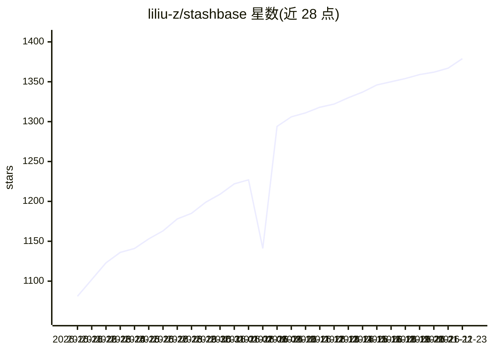

# liliu-z/stashbase

⭐ 1,379 · TypeScript · Apache-2.0 · 推送 2026-11-21 · [GitHub](https://github.com/liliu-z/stashbase) · [官网](https://stashbase.ai) · 个人维护

**本地知识库写作工作台：搭配 AI 代理写文档**

基于 Electron 的本地优先写作工作台，笔记、PDF 与 Word 文档存于本地文件夹；内置 Chat 与 IDE 式文档编辑双模式，AI 代理的修改可逐条审阅或撤销。代理可读取 PDF/Word/扫描件并在本机抽取文本，整理资料并回链来源；关键词检索离线可用，语义检索需自备 OpenAI 或 OpenRouter key。通过 MCP 配置可接入外部代理客户端。macOS 提供 Homebrew 安装与 dmg，Windows 提供 exe，Linux 提供 deb/AppImage，也可从源码构建。

## 筛选速览

| 维度 | 判定 | 备注 |
|---|---|---|
| AI 角色 | `ai-enhanced` | 去掉 AI 部分产品仍成立 |
| 许可风险 | `permissive` | Apache-2.0 |
| 部署形态 | `desktop` | 安装包/桌面程序 |
| 模型依赖 | — | README 未给出锁定关系 |
| 硬件要求 | — | 无带数字的原话,不猜 |
| 安装摩擦 | `low` | 无编译、无系统依赖或容器化 |
| 成熟度 | — | 结构信号不足 |

## 能力要点

- 本地优先：文档与关键词检索离线可用，PDF/Word/OCR 文本抽取在本机运行
- 支持 Claude、Codex、Antigravity 代理，使用用户自己的账号；含免费月度额度的 Default Agent
- 代理编辑在正文中逐条展示，可保留或撤销
- 通过 MCP 对外开放读取、检索与编辑能力

## 适用场景

- 让 AI 代理基于我的笔记和 PDF 资料起草文章
- 让代理帮我整理资料、更新笔记并链接到来源
- 不希望文档上传云端，只在本地写作

## 场景标签

`知识库管理` `RAG` · 领域:知识与检索

## 证据(README 行号)

> L10: StashBase is an open-source, local knowledge base for writing with AI agents.
> L14: - 📝 **Side by side with your agent.** Your docs stay open beside the
> L94: **Search by meaning** requires your own OpenAI or OpenRouter key in

## 星数曲线

2026-10-21 1,081 → 2026-11-23 1,379（+298）

---
*卡片 v1 · prompt 1.4 · 生成 2026-11-23 · 置信度 mid · 依据 README sha `fadcc5d6c043` · [字段定义](../../DATASET.md)*
