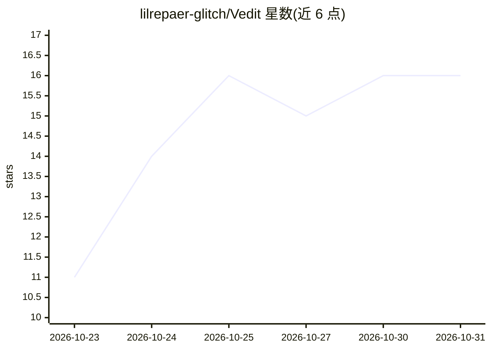

# lilrepaer-glitch/Vedit

⭐ 16 · TypeScript · 推送 2026-10-23 · [GitHub](https://github.com/lilrepaer-glitch/Vedit) · [官网](not.now) · 个人维护

**带 AI Copilot 的多轨视频编辑器（Windows/Android）**

面向 Windows 10/11 与 Android 8.0–15 的原生多轨非线性视频编辑器：提供四区可调工作区、触控/鼠标时间线、3D .cube LUT 调色、Split-Wipe 对比与 RGB 示波器、变速与画中画布局、硬件加速 FFmpeg 编码（NVENC/AMF/QSV/ProRes/HEVC）。AI 部分为 BYO 模式：用户自带 API Key 与 Base URL（OpenAI/OpenRouter/DeepSeek/NVIDIA NIM/Groq/Ollama/LM Studio 或任意 OpenAI 兼容端点）驱动自然语言 AI Copilot，应用本身可 100% 离线运行。另内置 MCP Server 供 Claude Desktop/Cursor 等 agent 调用。Android 为独立 APK，Windows 为 NSIS 安装包，含源码构建流程。

## 筛选速览

| 维度 | 判定 | 备注 |
|---|---|---|
| AI 角色 | `ai-enhanced` | 去掉 AI 部分产品仍成立 |
| 许可风险 | `none` | — |
| 部署形态 | `desktop` | 安装包/桌面程序 |
| 模型依赖 | local-ok | 支持本地模型 |
| 硬件要求 | — | 无带数字的原话,不猜 |
| 安装摩擦 | `medium` | 含编译或系统依赖之一 |
| 成熟度 | — | 结构信号不足 |

## 能力要点

- Windows/Android 双端原生应用，Android 端 100% 本地离线运行
- BYO API Key/Base URL/Model 的 AI Copilot，支持任意 OpenAI 兼容端点
- Cinema 3D .cube LUT、Split-Wipe 对比与广播级 RGB Scopes
- 硬件加速 FFmpeg 渲染（NVENC/AMF/QSV/ProRes/HEVC）
- 内置 MCP Server 供 Claude Desktop/Cursor 调用

## 适用场景

- 在手机或 PC 上做多轨剪辑、调色与变速等后期制作
- 自带 LLM API 让 AI Copilot 辅助完成编辑操作
- 离线环境下完成剪辑与导出（不依赖云端）

## 场景标签

`图像视频处理` · 领域:感知与多模态

## 证据(README 行号)

> L37: - **Native Standalone Android App (`Vedit.apk` — `com.vedit.studio`)**: Signed with APK Signature Scheme `v2 + v3` 
> L40: - **Bring Your Own API Key, Base URL & AI Model (`⚙ API & Model`)**: Connect OpenAI, OpenRouter, DeepSeek, NVIDIA N

## 星数曲线

2026-10-23 11 → 2026-10-31 16（+5）

---
*卡片 v1 · prompt 1.4 · 生成 2026-10-30 · 置信度 high · 依据 README sha `1ccba3cd7003` · [字段定义](../../DATASET.md)*
