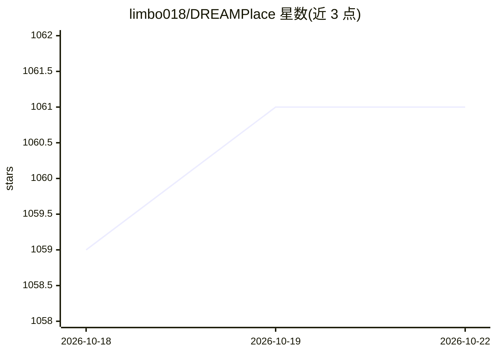

# limbo018/DREAMPlace

⭐ 1,061 · C++ · BSD-3-Clause · 推送 2026-07-18 · [GitHub](https://github.com/limbo018/DREAMPlace) · 组织维护

**面向VLSI物理设计研究者：深度学习工具链加速的布局工具**

DREAMPlace 是基于深度学习工具链（PyTorch）实现的 VLSI 布局工具，覆盖全局布局、合法化与详细布局，并集成 ABCDPlace 详细布局器与 HeteroSTA 时序分析引擎。通过将非线性布局问题类比为深度学习训练，在 CPU 和 GPU 上运行；README 报告在 ISPD 2005 基准上用 Tesla V100 相对 RePlAce CPU 实现超 30 倍加速。支持 Bookshelf 与 LEF/DEF 输入，需 CMake 从源码构建或使用 Docker 容器，CUDA/GPU 为可选依赖。主要由高校团队（Yibo Lin、David Z. Pan 指导）维护，发表 DAC/TCAD/ICCAD 系列论文。

## 筛选速览

| 维度 | 判定 | 备注 |
|---|---|---|
| AI 角色 | `ai-native` | 本体是模型或模型工具 |
| 许可风险 | `permissive` | BSD-3-Clause |
| 部署形态 | `self-host` | docker 或自建部署 |
| 模型依赖 | — | README 未给出锁定关系 |
| 硬件要求 | — | 无带数字的原话,不猜 |
| 安装摩擦 | `low` | 无编译、无系统依赖或容器化 |
| 成熟度 | — | 结构信号不足 |

## 能力要点

- 基于 PyTorch 实现全局布局、合法化与详细布局全流程
- 集成 ABCDPlace（GPU 加速详细布局）与 HeteroSTA 时序分析引擎
- 支持 Bookshelf 与 LEF/DEF 输入格式、线网加权与增量布局
- 提供 Docker 构建容器与 CMake 源码构建两种方式

## 适用场景

- 在 ISPD 2005/2015 基准上运行与复现布局算法实验
- 学术研究中做时序驱动、宏单元布局算法的参考实现
- 利用 GPU 加速大规模设计的全局与详细布局

## 场景标签

 · 领域:EDA/芯片物理设计

## 证据(README 行号)

> L3: Deep learning toolkit-enabled VLSI placement.
> L4: With the analogy between nonlinear VLSI placement and deep learning training problem, this tool is developed with de
> L5: The tool runs on both CPU and GPU.

## 星数曲线

2026-10-18 1,059 → 2026-10-22 1,061（+2）

---
*卡片 v1 · prompt 1.4 · 生成 2026-10-21 · 置信度 high · 依据 README sha `837027ba9d42` · [字段定义](../../DATASET.md)*
