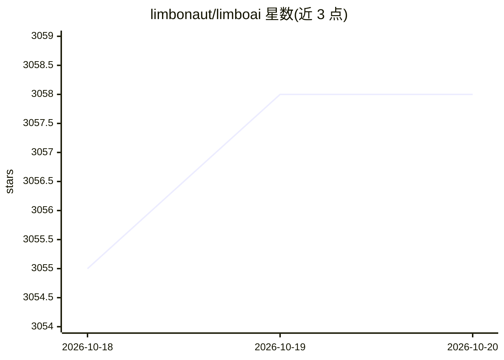

# limbonaut/limboai

⭐ 3,058 · C++ · MIT · 推送 2026-10-04 · [GitHub](https://github.com/limbonaut/limboai) · [官网](https://limboai.readthedocs.io/) · 个人维护

**Godot 4 的行为树与状态机 C++ 插件，用于构建游戏 AI 行为**

LimboAI 是 Godot Engine 4 的开源 C++ 插件，提供行为树与层级状态机（HSM）两套可组合使用的系统，用于建模和控制游戏中角色、敌人等 agent 的行为。附带行为树编辑器、内置文档、可视化调试器、Blackboard 数据共享系统和含教程的示例工程。可作为 GDExtension 共享库或 C++ 模块使用，两者项目兼容可随时切换；自定义任务与状态支持 GDScript。支持 Godot 4.2–4.6，以 MIT 风格许可发布。

## 筛选速览

| 维度 | 判定 | 备注 |
|---|---|---|
| AI 角色 | `ai-ecosystem` | LLM/agent 周边工具 |
| 许可风险 | `permissive` | MIT |
| 部署形态 | `None` |  |
| 模型依赖 | — | README 未给出锁定关系 |
| 硬件要求 | — | 无带数字的原话,不猜 |
| 安装摩擦 | `low` | 无编译、无系统依赖或容器化 |
| 成熟度 | — | 结构信号不足 |

## 能力要点

- 行为树编辑器、可视化调试器与 Blackboard 数据共享系统
- 层级状态机（LimboHSM）可嵌套，且可通过 BTState 与行为树组合
- GDExtension 与 C++ module 两种使用方式，项目兼容可切换
- 自定义任务支持 GDScript 与 C#（文档含 C# 用法）

## 适用场景

- 为游戏角色、敌人构建模块化的行为树 AI
- 用状态机管理游戏逻辑并与行为树组合
- 通过可视化调试器排查运行中的行为树执行问题

## 场景标签

 · 领域:游戏开发

## 证据(README 行号)

> L14: **LimboAI** is an open-source C++ plugin for **Godot Engine 4** providing a combination of
> L15: **Behavior Trees** and **State Machines**, which can be used together to create complex AI behaviors.

## 星数曲线

2026-10-18 3,055 → 2026-10-20 3,058（+3）

---
*卡片 v1 · prompt 1.4 · 生成 2026-10-20 · 置信度 high · 依据 README sha `a0743f2210aa` · [字段定义](../../DATASET.md)*
