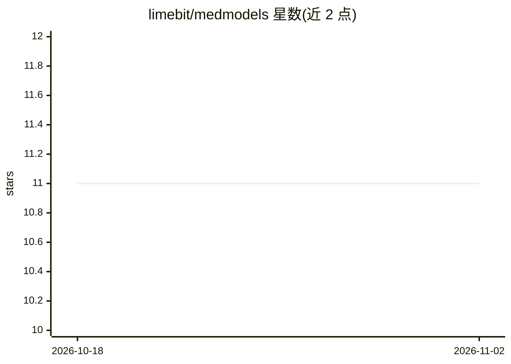

# limebit/medmodels

⭐ 11 · Python · BSD-3-Clause · 推送 2026-10-20 · [GitHub](https://github.com/limebit/medmodels) · [官网](https://www.medmodels.de) · 组织维护

**面向医学真实世界证据分析的 Rust 后端 Python 框架**

MedModels 是一个用于处理和分析电子健康记录（EHR）与理赔数据的 Python 框架，底层用 Rust 实现以处理大规模数据集。核心组件 MedRecord 将患者、用药、诊断等医学数据组织为图结构（节点与带属性边），支持从 Pandas/Polars DataFrame 及标准 Python 数据结构创建，并提供查询、分组、过滤操作。分析组件提供治疗效应估计（连续、二分类、生存分析结局）、Cohen's d 等效应量指标、倾向评分匹配与最近邻匹配。目标用户为药物流行病学家、真实世界数据分析师、卫生经济学家、临床医生与数据科学家。通过 PyPI 安装。

## 筛选速览

| 维度 | 判定 | 备注 |
|---|---|---|
| AI 角色 | `ai-native` | 本体是模型或模型工具 |
| 许可风险 | `permissive` | BSD-3-Clause |
| 部署形态 | `library` | 以包/库形式分发 |
| 模型依赖 | — | README 未给出锁定关系 |
| 硬件要求 | — | 无带数字的原话,不猜 |
| 安装摩擦 | `low` | 无编译、无系统依赖或容器化 |
| 成熟度 | — | 结构信号不足 |

## 能力要点

- Rust 后端的 MedRecord 图结构管理与高效查询
- 从 Pandas/Polars DataFrame 及标准 Python 结构创建 MedRecord
- 治疗效应估计：连续、二分类、时间到事件结局
- 倾向评分匹配与最近邻匹配

## 适用场景

- 在观察性数据上估计治疗效应与生存分析
- 将 EHR/理赔数据转为图结构做查询与分析
- 用倾向评分匹配控制混杂偏倚

## 场景标签

`数据分析` · 领域:效率与自动化

## 证据(README 行号)

> L22: Analyzing real-world evidence, especially patient data, is a complex task demanding accuracy and reproducibility. C
> L24: MedModels addresses these challenges by providing a standardized, reliable, and efficient framework for handling, p
> L30: - (Pharmaco-)Epidemiologists

## 星数曲线

2026-10-18 11 → 2026-11-02 11（+0）

---
*卡片 v1 · prompt 1.4 · 生成 2026-11-02 · 置信度 mid · 依据 README sha `26036d35da3b` · [字段定义](../../DATASET.md)*
