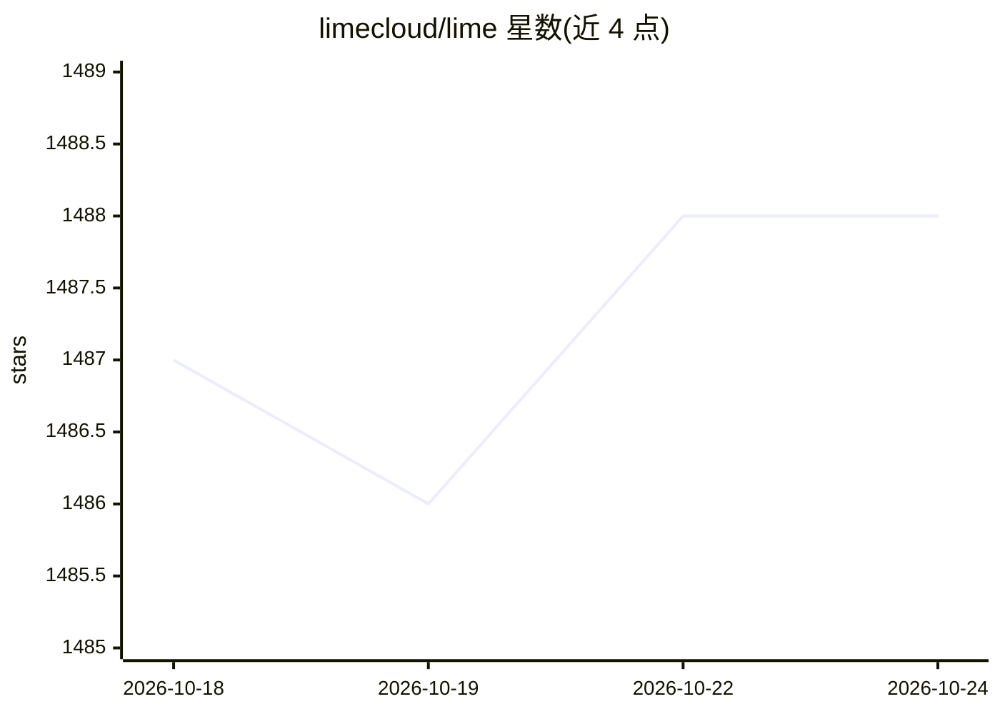

# limecloud/lime

⭐ 1,488 · TypeScript · 推送 2026-10-23 · [GitHub](https://github.com/limecloud/lime) · [官网](https://limeai.run) · 组织维护 · 中文 README

**开源全栈 AI Agent：桌面与 CLI/TUI 中完成编码、研究与内容交付**

面向用户与团队的开源全栈 AI Agent，以 Electron 桌面应用与 CLI/TUI 两种形态提供。Agent 循环整合文件读写、终端命令、工具调用、MCP、Skills、多模态输入输出、模型路由与多 Agent 协作，任务以 Thread/Turn/Item 结构可暂停、审查与恢复。自身不提供模型，用户自行配置 Provider 与凭据；材料默认保存在本地。GPLv3 许可，桌面端目前仅发布 macOS 与 Windows 构建，Linux 桌面构建暂停。

## 筛选速览

| 维度 | 判定 | 备注 |
|---|---|---|
| AI 角色 | `ai-native` | 本体是模型或模型工具 |
| 许可风险 | `none` | — |
| 部署形态 | `desktop` | 安装包/桌面程序 |
| 模型依赖 | — | README 未给出锁定关系 |
| 硬件要求 | — | 无带数字的原话,不猜 |
| 安装摩擦 | `low` | 无编译、无系统依赖或容器化 |
| 成熟度 | — | 结构信号不足 |

## 能力要点

- Agent 循环整合文件、终端、MCP、Skills 与多 Agent 协作
- Thread/Turn/Item 任务链，支持暂停、审查、恢复
- 桌面与 CLI/TUI 双形态，共用同一 App Server 与数据模型
- 多模态输入（图像/音视频/PDF/表格）与多模态产物生成

## 适用场景

- 让 Agent 读仓库、定位 bug、改代码并跑测试
- 把网页、笔记、截图等材料整理为报告或交付物
- 把重复流程编码为可复用 Skill 供 Agent 调用
- 在 SSH/服务器/CI 场景用 CLI 非交互执行任务

## 场景标签

`编码 Agent` `AI 写作` `科研工具` `多智能体` · 领域:Agent 开发

## 证据(README 行号)

> L26: Lime is an open-source full-stack AI agent for users and teams worldwide, available as an Electron Desktop app and 
> L45: - **Multimodal understanding and generation**: work with text, code, images, screenshots, audio, video, PDFs, table

## 星数曲线

2026-10-18 1,487 → 2026-10-24 1,488（+1）

---
*卡片 v1 · prompt 1.4 · 生成 2026-10-21 · 置信度 high · 依据 README sha `8bac8973f648` · [字段定义](../../DATASET.md)*
