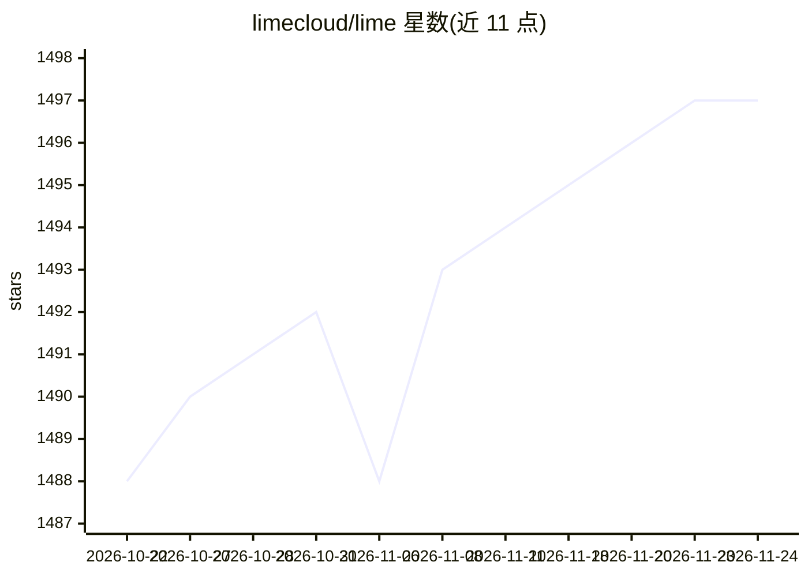

# limecloud/lime

⭐ 1,499 · Rust · GPL-3.0 · 推送 2026-11-18 · [GitHub](https://github.com/limecloud/lime) · [官网](https://limeai.run) · 组织维护 · 中文 README

**面向开发者与创作者的桌面/CLI 全栈 AI agent**

开源的全栈 AI agent，提供 Desktop 与 CLI/TUI 两种形态，围绕可审查的工作流组织任务：读取上下文、使用用户启用的工具、执行文件编辑与命令、产出可检查的结果（diff、报告、文件整理、内容草稿等）。本体不提供模型，需自行配置 provider 与凭据；本地数据默认留存，仅向所选服务发送远程请求所需内容；支持 MCP 工具接入、Skills 可复用流程，以及阿里云 ECS 云电脑的购买、安装、备份与释放管理。

## 筛选速览

| 维度 | 判定 | 备注 |
|---|---|---|
| AI 角色 | `ai-native` | 本体是模型或模型工具 |
| 许可风险 | `viral` | GPL-3.0 |
| 部署形态 | `library` | 以包/库形式分发 |
| 模型依赖 | — | README 未给出锁定关系 |
| 硬件要求 | — | 无带数字的原话,不猜 |
| 安装摩擦 | `low` | 无编译、无系统依赖或容器化 |
| 成熟度 | — | 结构信号不足 |

## 能力要点

- Desktop 与 CLI/TUI 双形态，CLI 基于 Node.js 18+，npm 全局安装
- 本身不内置模型，用户自选 provider/model 并接入 MCP 工具与 Skills
- 任务产出可审查：文件变更、命令结果、完成检查可在同一任务内继续
- 集成阿里云 ECS 云电脑的购买、运行时分发验证、备份与释放流程

## 适用场景

- 让 agent 修复 bug 或实现功能并给出带测试结果的 diff
- 对资料文件夹做研究并生成带来源的可编辑报告
- 用 Skills 把重复性工作流固化为带输入与审查标准的流程
- 购买并管理阿里云 ECS 作为 agent 的持久云端执行环境

## 场景标签

`编码 Agent` `AI 助手` `科研工具` · 领域:编码与开发

## 证据(README 行号)

> L7: An open-source full-stack AI agent for **Desktop and CLI/TUI**.
> L77: Lime hosts the agent workspace; it does not supply AI models. Choose your provider and model, connect MCP tools as 

## 星数曲线

2026-10-22 1,488 → 2026-11-24 1,497（+9）

---
*卡片 v1 · prompt 1.4 · 生成 2026-11-23 · 置信度 high · 依据 README sha `4213a65d2695` · [字段定义](../../DATASET.md)*
