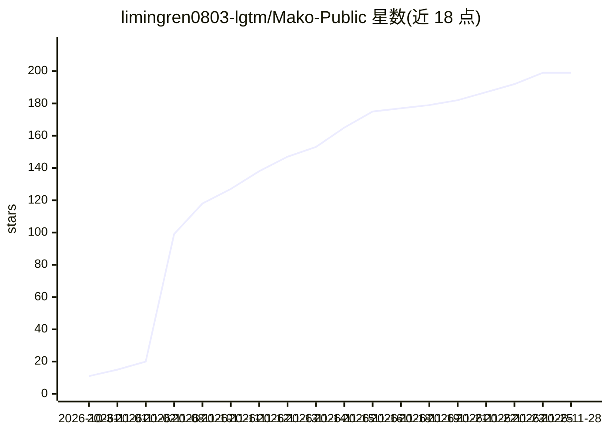

# limingren0803-lgtm/Mako-Public

⭐ 199 · Python · 推送 2026-11-20 · [GitHub](https://github.com/limingren0803-lgtm/Mako-Public) · 个人维护 · 中文 README

**面向留学生与应届生的 AI 求职分析与行动规划系统**

Mako 是一个自托管的 AI 求职智能系统，面向计划回国求职的留学生与国内应届生，提供背景诊断、岗位方向匹配、JD 分析、简历优化、面试准备和行动规划六项 Career Skill。机制上采用 FastAPI + Docker Compose 部署，Redis 存工作记忆、ChromaDB 提供情景记忆与 RAG 检索，职位数据经审核治理并保留官方来源与核验时间；分析结果标注证据与信息缺口，不自动写入结论。限制：单进程单实例部署、本地单用户工作区、无终端用户身份系统，扫描版 PDF/图片等格式不支持。

## 筛选速览

| 维度 | 判定 | 备注 |
|---|---|---|
| AI 角色 | `ai-native` | 本体是模型或模型工具 |
| 许可风险 | `none` | — |
| 部署形态 | `desktop` | 安装包/桌面程序 |
| 模型依赖 | — | README 未给出锁定关系 |
| 硬件要求 | — | 无带数字的原话,不猜 |
| 安装摩擦 | `low` | 无编译、无系统依赖或容器化 |
| 成熟度 | — | 结构信号不足 |

## 能力要点

- 六阶段求职任务：背景诊断→方向匹配→JD 分析→简历优化→面试准备→行动规划
- Redis 工作记忆 + ChromaDB 情景记忆与 RAG 知识检索，CareerProfile 异步画像更新
- 109 家企业招聘入口目录，JobPosting 先审核后生效并保留官方来源与核验时间
- 可安装 Codex Skill 轻量使用，无需启动 Docker 与后端

## 适用场景

- 上传简历与 JD，判断岗位是否值得投递、材料缺哪些证据
- 按目标岗位调整简历表达并准备面试追问
- 整理多个目标岗位与行动事项，跟踪投递阶段

## 场景标签

`多智能体` `RAG` · 领域:Agent 开发

## 证据(README 行号)

> L7:  Mako 面向计划回国求职的留学生，也服务国内应届生，从官方岗位中匹配、推荐适合你的岗位，把你的经历逐项对照岗位要求，整理出一条专属于你的求职路线。
> L149: 环境要求：Docker Desktop、Docker Compose v2，以及 Anthropic API Key 或支持 Anthropic 协议的兼容服务密钥。
> L197: |部署|Nginx 外部入口、FastAPI、Docker Compose|

## 星数曲线

2026-10-31 11 → 2026-11-28 199（+188）

---
*卡片 v1 · prompt 1.4 · 生成 2026-11-25 · 置信度 high · 依据 README sha `79564c035f50` · [字段定义](../../DATASET.md)*
