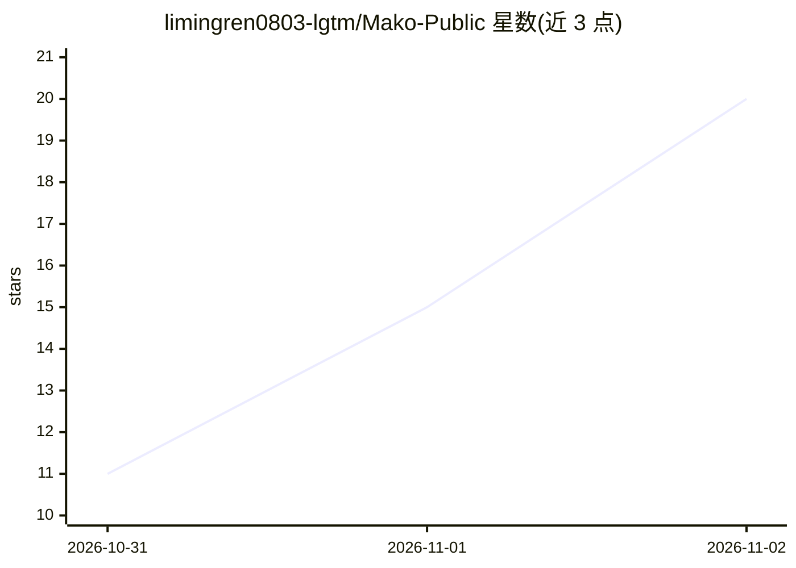

# limingren0803-lgtm/Mako-Public

⭐ 20 · Python · 推送 2026-08-31 · [GitHub](https://github.com/limingren0803-lgtm/Mako-Public) · 个人维护 · 中文 README

**面向回国留学生与国内应届生的 AI 求职分析与规划系统**

Mako 是基于多 Agent 架构（General/Technical/CareerAgent）的求职智能系统，提供背景诊断、岗位方向匹配、JD 分析、简历优化、面试准备与行动规划六项任务。用户材料经确认后参与分析，结果标注证据支持与信息缺口；职位信息来自 23 家企业官方来源的登记、核验与审核（当前 35 条已审核结构化样本）。提供 FastAPI+Nginx+Redis+ChromaDB+Prometheus 共 5 个 Docker 服务的本地部署，以及可安装到 Codex 的轻量 Career Skill。工作区为本地单用户，使用 SQLite 与 ChromaDB 存储，无云端账户。

## 筛选速览

| 维度 | 判定 | 备注 |
|---|---|---|
| AI 角色 | `ai-native` | 本体是模型或模型工具 |
| 许可风险 | `none` | — |
| 部署形态 | `desktop` | 安装包/桌面程序 |
| 模型依赖 | — | README 未给出锁定关系 |
| 硬件要求 | — | 无带数字的原话,不猜 |
| 安装摩擦 | `low` | 无编译、无系统依赖或容器化 |
| 成熟度 | — | 结构信号不足 |

## 能力要点

- 六项求职任务链式衔接：诊断→匹配→JD→简历→面试→行动
- 23 家企业官方招聘来源目录，职位经安全检查、版本管理与人工审核
- 匹配结果逐项标注证据状态与信息缺口，不补写未提供的事实
- Skill 可安装到 Codex 免部署使用，完整系统 5 个 Docker 服务一键启动

## 适用场景

- 回国求职的留学生把海外经历对应到国内岗位要求
- 比较岗位方向、判断哪些 JD 值得投递
- 按证据缺口优化简历并生成行动计划
- 在本地工作台持续跟进目标岗位与截止时间

## 场景标签

`多智能体` · 领域:Agent 开发

## 证据(README 行号)

> L11:  Mako 面向计划回国求职的留学生，也服务国内应届生，从官方岗位中匹配、推荐适合你的岗位，把你的经历逐项对照岗位要求，整理出一条专属于你的求职路线。
> L175: |Agent|GeneralAgent、TechnicalAgent、CareerAgent|

## 星数曲线

2026-10-31 11 → 2026-11-02 20（+9）

---
*卡片 v1 · prompt 1.4 · 生成 2026-10-31 · 置信度 high · 依据 README sha `438318e676fe` · [字段定义](../../DATASET.md)*
