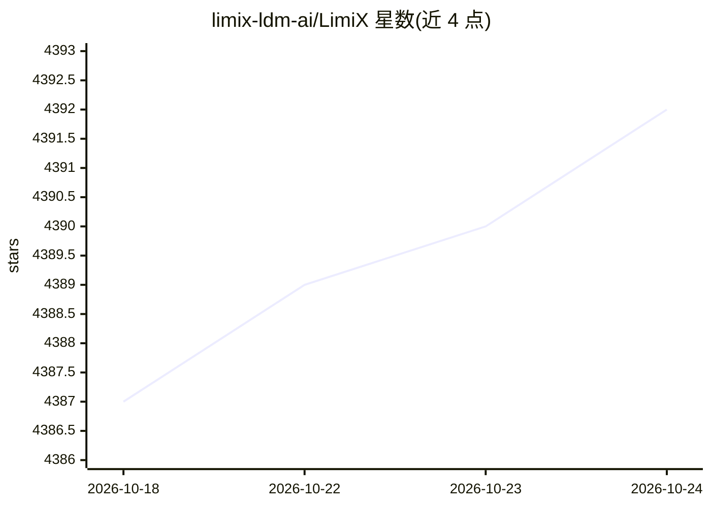

# limix-ldm-ai/LimiX

⭐ 4,392 · Python · NOASSERTION · 推送 2026-09-18 · [GitHub](https://github.com/limix-ldm-ai/LimiX) · [官网](https://www.limix.ai) · 组织维护 · 中文 README

**结构化数据（表格）基础模型：单模型完成分类/回归/缺失值填补**

LimiX-2 是面向表格数据的预训练基础模型（400M，另有 2M/16M 轻量版），采用上下文机制网络（CMN）范式，以上下文条件掩码建模（CCMM）在结构因果模型生成的合成数据上预训练。单一模型经一次前向传播即可完成分类、回归与缺失值填补，无需任务特定参数更新；官方还报告了特征注意力可恢复因果骨架。提供推理代码、LimiX-infer CLI 与 Python 接口（LimiXPredictor），权重下载自 HuggingFace/ModelScope。代码 Apache 2.0，LimiX-2 权重受 StableAI 非商业许可约束；需 Python ≥3.12、torch ≥2.9.1，支持 CUDA 与 CPU 设备。

## 筛选速览

| 维度 | 判定 | 备注 |
|---|---|---|
| AI 角色 | `ai-native` | 本体是模型或模型工具 |
| 许可风险 | `none` | NOASSERTION |
| 部署形态 | `library` | 以包/库形式分发 |
| 模型依赖 | — | README 未给出锁定关系 |
| 硬件要求 | — | 无带数字的原话,不猜 |
| 安装摩擦 | `medium` | 含编译或系统依赖之一 |
| 成熟度 | — | 结构信号不足 |

## 能力要点

- 单一预训练模型一次前向完成分类/回归/缺失值填补，无需任务特定训练
- 提供 400M / 16M / 2M 三个参数规模的检查点
- CLI（LimiX-infer）与 Python 接口（LimiXPredictor）两种推理入口
- 报告了 12.5M–406.2M 参数区间的 log-linear 缩放律研究

## 适用场景

- 在缺少训练数据的表格数据集上直接做分类或回归预测
- 为含缺失值的表格数据做特征填补
- 学术研究对比表格基础模型性能（TabArena/TALENT/BCCO 基准）

## 场景标签

 · 领域:机器学习/表格基础模型

## 证据(README 行号)

> L31: LimiX-2 is the new-generation model of the LimiX family, developed through model and data scaling guided by our pre
> L45: |LimiX-2|400M|16 Sept 2026|LimiX-2.ckpt|✅ cls ✅ reg ✅ imputation|

## 星数曲线

2026-10-18 4,387 → 2026-10-24 4,392（+5）

---
*卡片 v1 · prompt 1.4 · 生成 2026-10-20 · 置信度 high · 依据 README sha `26402ffe8ed0` · [字段定义](../../DATASET.md)*
