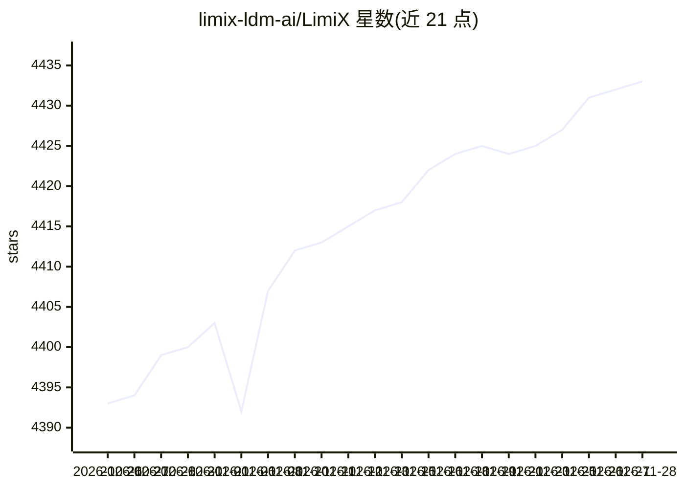

# limix-ldm-ai/LimiX

⭐ 4,433 · Python · NOASSERTION · 推送 2026-11-27 · [GitHub](https://github.com/limix-ldm-ai/LimiX) · [官网](https://www.limix.ai) · 组织维护 · 中文 README

**面向表格数据的结构化基础模型，支持分类/回归/插补**

LimiX 是针对结构化（表格）数据的预训练基础模型系列，提供 2M/16M/400M 参数等多个权重。单个预训练模型在一次前向中完成分类、回归与缺失值插补，无需任务特定参数更新；采用上下文机制网络（CMN）范式，预训练数据由结构因果模型生成的合成数据构成。通过 PyPI 包 ldm-limix 安装，提供 LimiX-infer 命令行入口与 LimiXPredictor Python 接口读取 CSV 数据。权重遵循 StableAI LimiX 非商业许可（早期版本为 Apache 2.0）。

## 筛选速览

| 维度 | 判定 | 备注 |
|---|---|---|
| AI 角色 | `ai-native` | 本体是模型或模型工具 |
| 许可风险 | `none` | NOASSERTION |
| 部署形态 | `library` | 以包/库形式分发 |
| 模型依赖 | — | README 未给出锁定关系 |
| 硬件要求 | — | 无带数字的原话,不猜 |
| 安装摩擦 | `medium` | 含编译或系统依赖之一 |
| 成熟度 | — | 结构信号不足 |

## 能力要点

- 单个预训练模型一次前向完成分类、回归与缺失值插补
- 提供 2M/16M/400M 参数的多个权重与 CLI（LimiX-infer）及 Python 接口
- 预训练采用 SCM 生成的合成数据与 CCMM 上下文条件掩码建模
- README 给出 TabArena、TALENT、BCCO 三个基准上的评测结果与 scaling law 数据

## 适用场景

- 在表格数据上做分类或回归预测
- 对含缺失值的特征进行插补
- 以命令行批量对基准目录中的多个数据集推理

## 场景标签

`数据分析` · 领域:效率与自动化

## 证据(README 行号)

> L25: - **[16 Sept 2026] 🚀 LimiX-2 open-source release.** The LimiX-2 weights (`LimiX-2.ckpt`) and inference code are rel
> L39: |LimiX-2-1016|400M|10 Nov 2026|LimiX-2-1016.ckpt|✅ cls ✅ reg ✅ imputation|
> L208: LimiX supports classification, regression, and missing-value imputation. The public entry point is `ldm_limix.Limi

## 星数曲线

2026-10-26 4,393 → 2026-11-28 4,433（+40）

---
*卡片 v1 · prompt 1.4 · 生成 2026-11-28 · 置信度 high · 依据 README sha `1e070451a060` · [字段定义](../../DATASET.md)*
