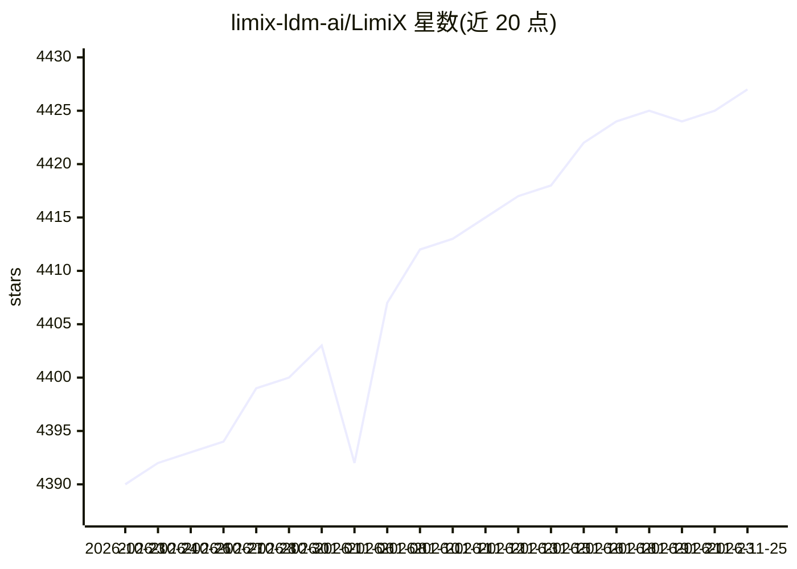

# limix-ldm-ai/LimiX

⭐ 4,427 · Python · NOASSERTION · 推送 2026-11-23 · [GitHub](https://github.com/limix-ldm-ai/LimiX) · [官网](https://www.limix.ai) · 组织维护 · 中文 README

**面向结构化数据的表格基础模型：分类/回归/插补推理**

LimiX 系列是针对表格等结构化数据的预训练基础模型，单个模型在前向传播中执行分类、回归与缺失值插补，无需任务特定参数更新。提供 400M（LimiX-2/LimiX-2-1016）与 2M/16M 轻量级多个规模的权重，采用 CMN 范式与合成数据（结构因果模型生成）预训练。通过 pip 安装后提供 LimiX-infer 命令行与 LimiXPredictor Python 入口；要求 Python>=3.12，LimiX-2 权重采用非商业许可。

## 筛选速览

| 维度 | 判定 | 备注 |
|---|---|---|
| AI 角色 | `ai-native` | 本体是模型或模型工具 |
| 许可风险 | `none` | NOASSERTION |
| 部署形态 | `library` | 以包/库形式分发 |
| 模型依赖 | — | README 未给出锁定关系 |
| 硬件要求 | — | 无带数字的原话,不猜 |
| 安装摩擦 | `medium` | 含编译或系统依赖之一 |
| 成熟度 | — | 结构信号不足 |

## 能力要点

- 单一预训练模型在一次前向传播中完成分类、回归与缺失值插补
- 提供 2M 到 400M 多种参数规模的权重文件
- pip 包 ldm-limix 提供 LimiX-infer 命令行与 LimiXPredictor 入口
- 在 TabArena、TALENT、BCCO 三个基准上给出评测结果

## 适用场景

- 表格数据的分类与回归建模
- 数据集中缺失值的插补
- 以命令行方式对本地 CSV 数据集批量推理

## 场景标签

 · 领域:机器学习/表格数据建模

## 证据(README 行号)

> L25: - **[16 Sept 2026] 🚀 LimiX-2 open-source release.** The LimiX-2 weights (`LimiX-2.ckpt`) and inference code are rel
> L208: LimiX supports classification, regression, and missing-value imputation. The public entry point is `ldm_limix.Limi
> L31:  Paper: arXiv:2509.03505. LimiX is the first structured-data large model for generalist intelligence, and the proje

## 星数曲线

2026-10-23 4,390 → 2026-11-25 4,427（+37）

---
*卡片 v1 · prompt 1.4 · 生成 2026-11-24 · 置信度 high · 依据 README sha `0548f3cf76e0` · [字段定义](../../DATASET.md)*
