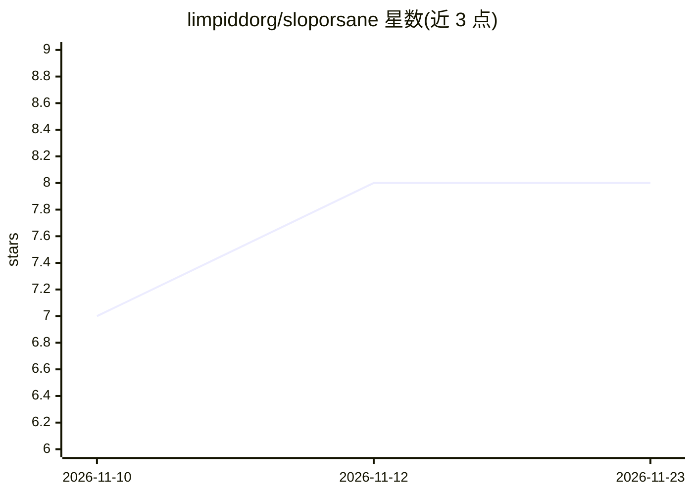

# limpiddorg/sloporsane

⭐ 8 · C++ · MIT · 推送 2026-11-18 · [GitHub](https://github.com/limpiddorg/sloporsane) · [官网](https://www.limpidd.com/) · 个人维护

**AI 编码 harness（TUI/CLI）：让人审查并掌控 AI 生成代码**

一个终端界面的 AI 编码 harness，目标是让 AI 生成的代码更易被理解。提供两种模式：Slop 为常规对话式代理体验；Sane 将实现拆解为人类可读的步骤，每个 diff 附带解释，用户可逐个阅读、批准、质询或调整后再进入下一步，由人决定哪些代码可以交付。通过 /connect 配置模型 provider；以 curl 安装脚本分发，支持 macOS 15+ (Apple Silicon) 与 Linux x86_64 (glibc 2.39+)，MIT 许可，自述处于早期开发阶段。

## 筛选速览

| 维度 | 判定 | 备注 |
|---|---|---|
| AI 角色 | `ai-native` | 本体是模型或模型工具 |
| 许可风险 | `permissive` | MIT |
| 部署形态 | `None` |  |
| 模型依赖 | — | README 未给出锁定关系 |
| 硬件要求 | — | 无带数字的原话,不猜 |
| 安装摩擦 | `low` | 无编译、无系统依赖或容器化 |
| 成熟度 | `idea` | |

## 能力要点

- Sane 模式逐步实现，每个 diff 附解释，可逐批准或质询
- Slop 模式提供对话式 agent 编码体验
- 通过 /connect 配置模型 provider
- TUI 界面，curl 脚本安装

## 适用场景

- 想让 AI 写代码但要求自己读懂并批准每处改动
- 以人机协作方式逐步完成软件实现
- 团队中由人决定 AI 生成代码能否交付

## 场景标签

`编码 Agent` `代码审查` · 领域:编码与开发

## 证据(README 行号)

> L8: An AI coding harness designed to make AI-generated code easier to understand.
> L39: - **Sane** breaks implementation into steps that make sense to a human, with explanations for each diff. You can re

## 星数曲线

2026-11-10 7 → 2026-11-23 8（+1）

---
*卡片 v1 · prompt 1.4 · 生成 2026-11-20 · 置信度 high · 依据 README sha `7946920cded4` · [字段定义](../../DATASET.md)*
