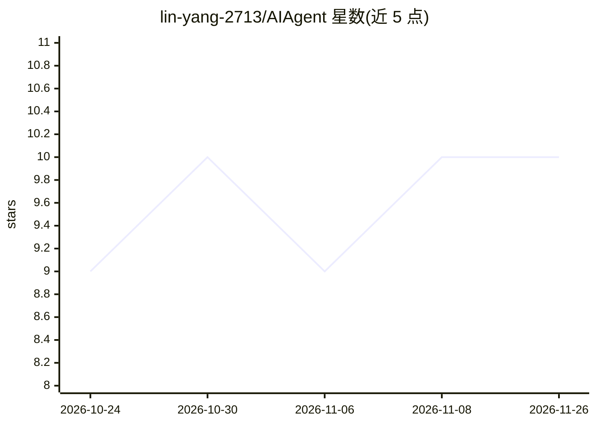

# lin-yang-2713/AIAgent

⭐ 10 · Python · 推送 2026-09-30 · [GitHub](https://github.com/lin-yang-2713/AIAgent) · 个人维护

**多智能体协作的 AI 网站生成器：从文本提示生成完整站点**

AgentSite 以九个专职 agent（PM、Designer、Developer、Reviewer 及 Markup/Style/Script/Image 等专家）组成流水线，从单一文本提示规划、设计、编码并评审，生成多页语义 HTML 站点。Reviewer 按可访问性、语义标记等维度打分，低于阈值触发最多两轮修订。提供 Web UI（实时预览、WebSocket 进度、聊天式生成）与 CLI 两种方式。流水线模型无关，经 Prompture 接入 OpenAI、Claude、Ollama 等多家提供商。Python 3.10+，MIT 许可，PyPI 安装，另提供 Docker 镜像与 Railway/Heroku/Render 部署入口。

## 筛选速览

| 维度 | 判定 | 备注 |
|---|---|---|
| AI 角色 | `ai-native` | 本体是模型或模型工具 |
| 许可风险 | `permissive` | — |
| 部署形态 | `library` | 以包/库形式分发 |
| 模型依赖 | local-ok | 支持本地模型 |
| 硬件要求 | — | 无带数字的原话,不猜 |
| 安装摩擦 | `low` | 无编译、无系统依赖或容器化 |
| 成熟度 | — | 结构信号不足 |

## 能力要点

- 九 agent 流水线：规划、设计、开发、评审，含最多两轮修订循环
- 模型无关：经 Prompture 支持 OpenAI/Claude/Google/Groq/Ollama/LM Studio 等
- Web UI 提供实时预览、每 agent 状态/token 用量监控与运行中 Steer 调整
- 内置 8 个技能目录与 4 套设计系统，输出强制 WCAG AA 可访问性检查

## 适用场景

- 用一段自然语言提示生成完整多页网站
- 通过 Web UI 对话式迭代页面并实时预览效果
- 为生成的站点套用预设设计系统与页面技能模板

## 场景标签

`多智能体` `代码生成` · 领域:Agent 开发

## 证据(README 行号)

> L17: An AI-powered website builder that uses multi-agent orchestration to generate complete, production-ready websites f
> L27: The entire pipeline is **model-agnostic**. You can use OpenAI, Claude, Google, Groq, Ollama, LM Studio, or any prov

## 星数曲线

2026-10-24 9 → 2026-11-26 10（+1）

---
*卡片 v1 · prompt 1.4 · 生成 2026-11-19 · 置信度 high · 依据 README sha `74547a52b24e` · [字段定义](../../DATASET.md)*
