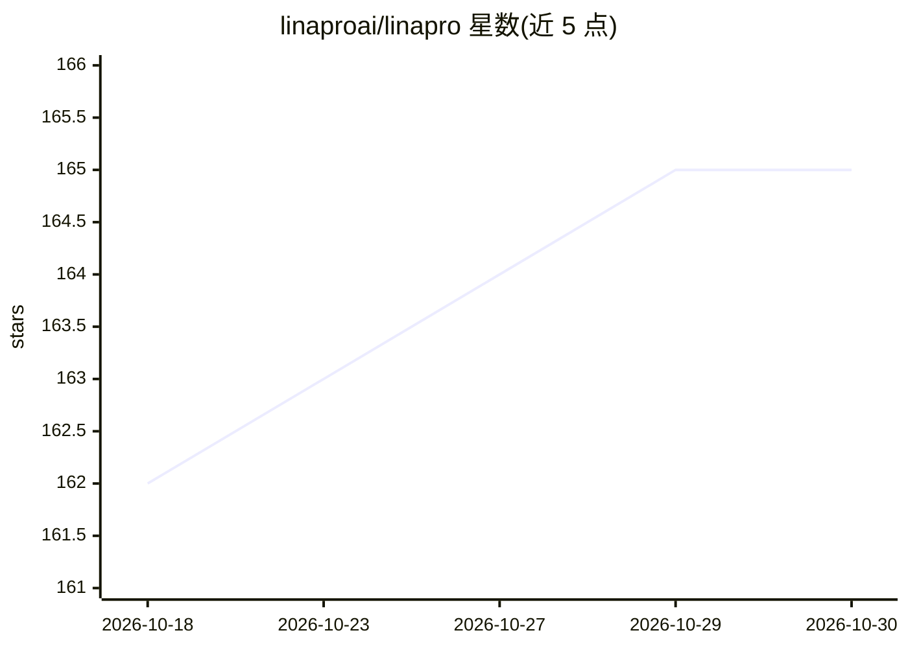

# linaproai/linapro

⭐ 165 · Go · Apache-2.0 · 推送 2026-09-07 · [GitHub](https://github.com/linaproai/linapro) · [官网](https://linapro.ai) · 组织维护 · 中文 README

**面向团队与企业的 AI 原生全栈开发框架**

LinaPro 是一个 AI 原生全栈框架：后端基于 Go（GoFrame），前端基于 Vue 3（Vben 5 模板 + Ant Design Vue + Vite），默认使用 PostgreSQL。核心机制包括规范驱动的 AI 开发工作流（AI 主导分析/设计/实现，变更锚定增量规范与强制 E2E 测试）、覆盖开发全生命周期的十余个内置 AI 技能、源码插件与 WASM 动态插件的双模式插件运行时，以及 JWT 认证、声明式 RBAC、多租户、Redis 协调的集群模式等企业能力。面向个人开发者、工程团队与企业。README 未给出安装命令。

## 筛选速览

| 维度 | 判定 | 备注 |
|---|---|---|
| AI 角色 | `ai-ecosystem` | LLM/agent 周边工具 |
| 许可风险 | `permissive` | Apache-2.0 |
| 部署形态 | `None` |  |
| 模型依赖 | — | README 未给出锁定关系 |
| 硬件要求 | — | 无带数字的原话,不猜 |
| 安装摩擦 | `low` | 无编译、无系统依赖或容器化 |
| 成熟度 | — | 结构信号不足 |

## 能力要点

- 规范驱动的 AI 开发工作流，AI 主导分析与实现并强制 E2E 测试
- 内置十余个覆盖全开发生命周期的 AI 技能
- 源码插件与 WASM 动态插件双模式插件运行时
- JWT + 声明式 RBAC、多租户、Redis 集群协调等企业能力

## 适用场景

- 团队跳过从零搭建基础设施，直接以 AI 工作流驱动业务开发
- 构建需要权限控制与审计的后台管理系统
- 通过插件体系扩展或替换框架能力
- 部署多租户或水平扩展的企业级应用

## 场景标签

`编码 Agent` · 领域:编码与开发

## 证据(README 行号)

> L20: `LinaPro` is an **AI-native full-stack framework built for sustainable delivery**. It brings together a specificati
> L36: - **AI-native development workflow**: Ships with a specification-driven AI development workflow, with first-class s

## 星数曲线

2026-10-18 162 → 2026-10-30 165（+3）

---
*卡片 v1 · prompt 1.4 · 生成 2026-10-22 · 置信度 mid · 依据 README sha `e3bf03ba70b6` · [字段定义](../../DATASET.md)*
