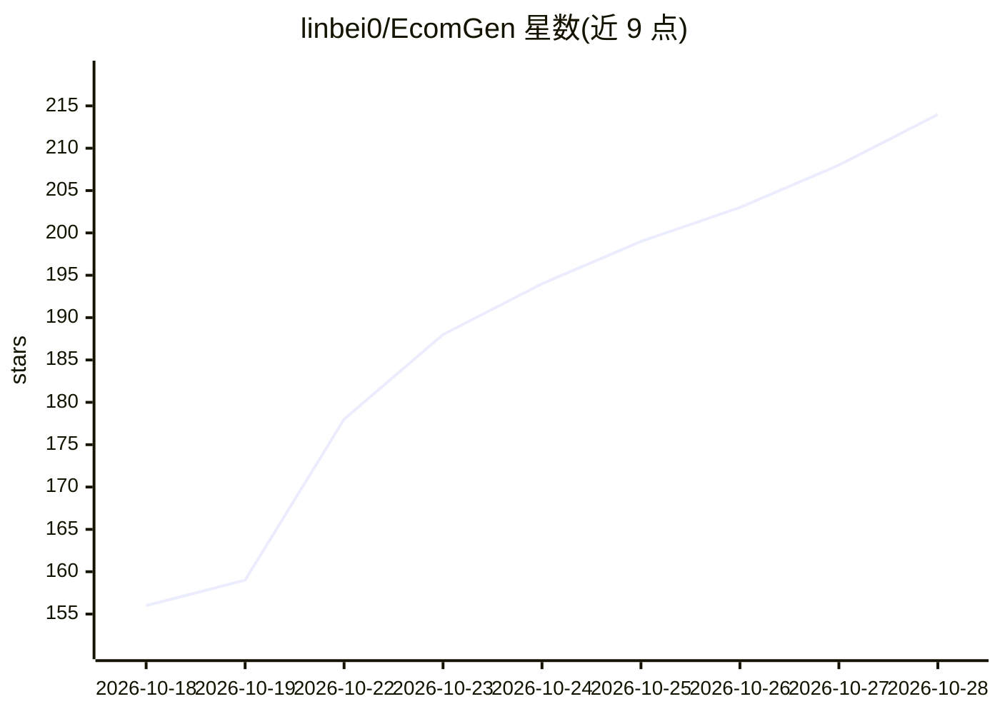

# linbei0/EcomGen

⭐ 217 · TypeScript · MIT · 推送 2026-10-24 · [GitHub](https://github.com/linbei0/EcomGen) · 个人维护 · 中文 README

**面向个人卖家的本地自托管电商 AI 套图生成工作台**

自托管的电商图片生成工作台：将商品事实、素材、目标市场与平台要求整理为可审核分镜，由 Pi Agent 生成最终 Prompt，BullMQ Worker 调用 OpenAI-compatible Images 或 Google Gemini（Nano Banana）生图、编辑、审核，并自动分层导出 PNG/ZIP/PSD。内置 25 种模板与 1100+ 套图，提供套图工坊、花型工坊、模特库等模块。需 Node.js 22+、pnpm、Redis 与外部图像 Provider，支持 Docker Compose 部署。

## 筛选速览

| 维度 | 判定 | 备注 |
|---|---|---|
| AI 角色 | `ai-native` | 本体是模型或模型工具 |
| 许可风险 | `permissive` | MIT |
| 部署形态 | `self-host` | docker 或自建部署 |
| 模型依赖 | — | README 未给出锁定关系 |
| 硬件要求 | — | 无带数字的原话,不猜 |
| 安装摩擦 | `low` | 无编译、无系统依赖或容器化 |
| 成熟度 | — | 结构信号不足 |

## 能力要点

- Pi Agent 分镜规划生成最终 Prompt，25 种模板 + 1100+ 可复用套图
- 支持 OpenAI-compatible Images 与 Gemini 原生生图（Nano Banana）双通道
- AI 分层导出 PNG/ZIP/PSD，PIXEL_PROTECTED 模式强制使用商品真值素材
- Docker Compose 单端口部署，自托管本地优先

## 适用场景

- 个人卖家为电商详情页批量生成整套商品图
- 从爆款图片反推可复用的套图模板
- POD 花型资产的起稿、验缝与规格包产出

## 场景标签

`图像生成` · 领域:内容生成

## 证据(README 行号)

> L5: EcomGen 是面向个人卖家的本地优先电商 AI 套图工作台。它把商品事实、商品素材、目标市场和平台要求整理成可审核的分镜，再由 Worker 调用兼容 OpenAI 的图像 Provider 生成、编辑、审核、分层并导出整套图片
> L28: - **Provider 管理**：配置推理、生图和图像分割 Provider，覆盖 OpenAI-compatible Images、Google Gemini 原生生图（Nano Banana）以及多种分割协议，生图分辨率、质

## 星数曲线

2026-10-18 156 → 2026-10-28 214（+58）

---
*卡片 v1 · prompt 1.4 · 生成 2026-10-22 · 置信度 high · 依据 README sha `250ec041036b` · [字段定义](../../DATASET.md)*
