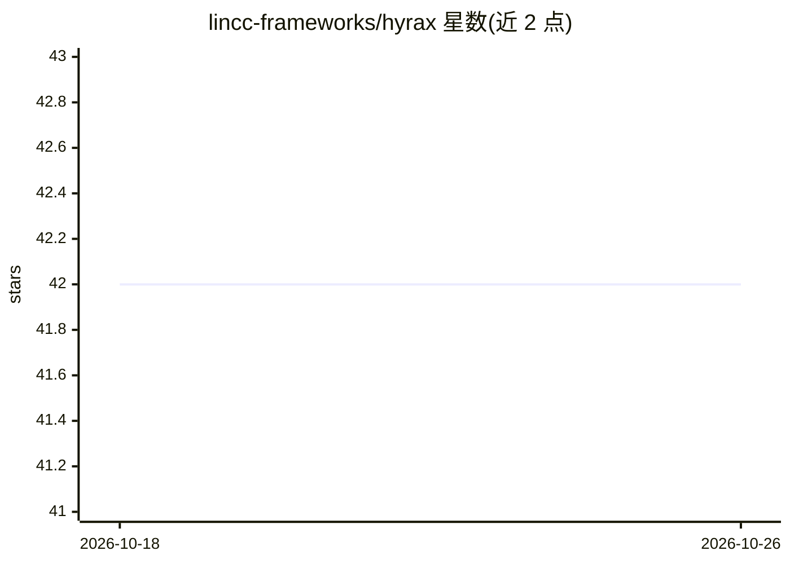

# lincc-frameworks/hyrax

⭐ 42 · Python · MIT · 推送 2026-10-25 · [GitHub](https://github.com/lincc-frameworks/hyrax) · [官网](https://hyrax.readthedocs.io/) · 组织维护

**面向天文学的低代码 ML 实验框架，减少样板代码**

Hyrax 是一个可扩展的机器学习平台，用于处理天文学 ML 项目中常见的样板代码，让用户专注于模型开发与结果分析的科学工作本身。它不绑定特定模型或数据模态，支持单模态与多模态数据、监督与无监督模型，凡是能用 PyTorch 实现的算法都可能在其上减少可复现项目的样板代码。项目由 LINCC Frameworks Team 与 LSST Discovery Alliance 合作发起，支持 Python 3.11-3.13，通过 pip 安装。限制：其他 Python 版本不保证兼容。

## 筛选速览

| 维度 | 判定 | 备注 |
|---|---|---|
| AI 角色 | `ai-ecosystem` | LLM/agent 周边工具 |
| 许可风险 | `permissive` | MIT |
| 部署形态 | `library` | 以包/库形式分发 |
| 模型依赖 | — | README 未给出锁定关系 |
| 硬件要求 | — | 无带数字的原话,不猜 |
| 安装摩擦 | `low` | 无编译、无系统依赖或容器化 |
| 成熟度 | — | 结构信号不足 |

## 能力要点

- 不绑定特定模型或数据模态，鼓励模型与数据生态
- 支持单模态/多模态数据与监督/无监督模型
- 基于 PyTorch，目标为可复现项目
- 已有 Rubin-LSST、HSC、ZTF 等天文学项目应用

## 适用场景

- 在天文图像/光谱/时序数据上快速搭建 ML 实验流程
- 进行无监督天体发现（如引力透镜弧、星系搜索）
- 复用框架减少 ML 项目基础设施代码

## 场景标签

`MLOps` · 领域:训练与推理

## 证据(README 行号)

> L9: Hyrax is an extensible platform that handles much of the boilerplate code that is often required for a machine learn
> L12: If the algorithm you want can be implemented in PyTorch, then Hyrax can likely reduce the boilerplate code required

## 星数曲线

2026-10-18 42 → 2026-10-26 42（+0）

---
*卡片 v1 · prompt 1.4 · 生成 2026-10-25 · 置信度 high · 依据 README sha `65ee857cb885` · [字段定义](../../DATASET.md)*
