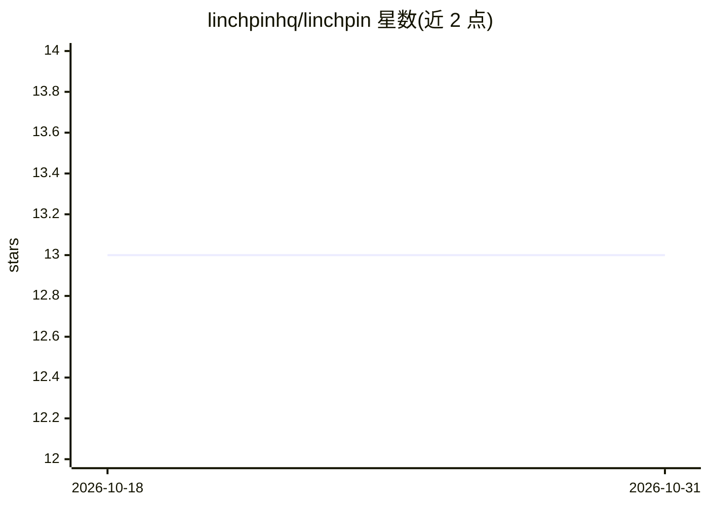

# linchpinhq/linchpin

⭐ 13 · Python · Apache-2.0 · 推送 2026-05-24 · [GitHub](https://github.com/linchpinhq/linchpin) · [官网](https://linchpin.work) · 组织维护

**自托管托管式 AI agent 运行时，带沙箱与工具权限**

Linchpin 是一个 Apache-2.0 开源、可自托管的 managed AI agent 运行时：用户定义 agent（模型+系统提示+工具+权限）与环境（容器模板），启动会话后为每个会话启动隔离的 Docker 容器，驱动 agent 循环并通过 SSE 流式返回消息、工具调用与状态。模型接入覆盖 OpenRouter 云端模型（Claude、GPT、Gemini、Llama、DeepSeek、Mistral、Qwen 等）与本地 Ollama。内置 8 种工具、MCP/HTTP 自定义工具、always_allow/always_ask 权限控制、加密凭据库与 React Web 控制台。运行需 Docker + Docker Compose。

## 筛选速览

| 维度 | 判定 | 备注 |
|---|---|---|
| AI 角色 | `ai-ecosystem` | LLM/agent 周边工具 |
| 许可风险 | `permissive` | Apache-2.0 |
| 部署形态 | `self-host` | docker 或自建部署 |
| 模型依赖 | local-ok | 支持本地模型 |
| 硬件要求 | — | 无带数字的原话,不猜 |
| 安装摩擦 | `low` | 无编译、无系统依赖或容器化 |
| 成熟度 | — | 结构信号不足 |

## 能力要点

- 每会话独立 Docker 容器沙箱，网络策略可设为无出站/完全出站
- 模型接入：OpenRouter 约 200 个云端模型 + 本地 Ollama
- 内置 bash/read/write/edit/glob/grep/web_fetch/web_search 工具，MCP 与 HTTP 工具扩展
- 工具级 always_ask 权限确认与 SSE 事件流（含 cursor 回放）

## 适用场景

- 在自己基础设施上运行和管理多模型 AI agent
- 为 agent 会话提供隔离沙箱与工具权限审批流程
- 通过 Web 控制台或 /v1 API 管理agent、环境、会话与凭据

## 场景标签

`Agent 框架` · 领域:Agent 开发

## 证据(README 行号)

> L15: Linchpin is an open standard and self-hostable runtime for **managed AI agents**. Run a managed-agent system on you
> L17: You define **agents** (model + system prompt + tools + permissions) and **environments** (container templates). You
> L21: Requires Docker + Docker Compose.

## 星数曲线

2026-10-18 13 → 2026-10-31 13（+0）

---
*卡片 v1 · prompt 1.4 · 生成 2026-10-31 · 置信度 mid · 依据 README sha `5f43ffe1f4ca` · [字段定义](../../DATASET.md)*
