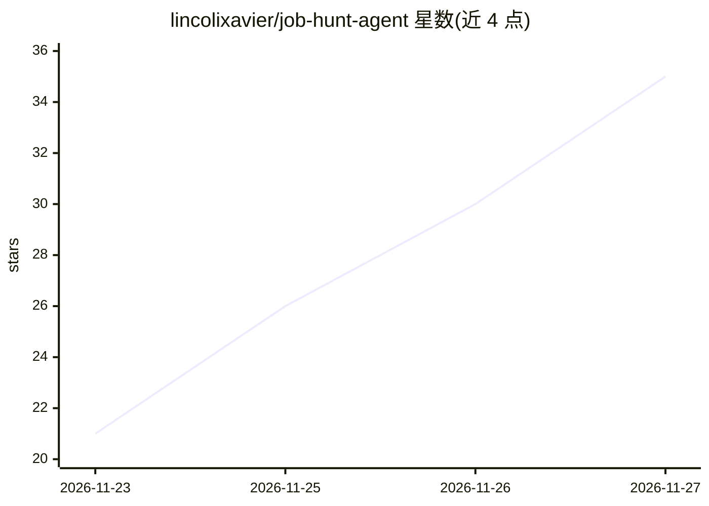

# lincolixavier/job-hunt-agent

⭐ 35 · Python · MIT · 推送 2026-11-21 · [GitHub](https://github.com/lincolixavier/job-hunt-agent) · 个人维护

**把 AI 编码代理改造成求职助理的工作流与 CLI**

提供 AGENTS.md 工作流和一个零依赖 Python CLI，将 AI 编码代理（Claude Code 默认，也支持 Codex/Cursor 等）组织为求职助理：按用户硬性规则筛选职位、基于 cv.toml 事实数据生成单页定制简历 PDF、给出符合薪资下限的要价、维护 tracker.csv 申请记录并拒绝重复申请。代理不发未批准的消息、不处理密码或 CAPTCHA；数据保存在本地 gitignored 目录。Python 3.11+，无第三方依赖。

## 筛选速览

| 维度 | 判定 | 备注 |
|---|---|---|
| AI 角色 | `ai-ecosystem` | LLM/agent 周边工具 |
| 许可风险 | `permissive` | MIT |
| 部署形态 | `None` |  |
| 模型依赖 | — | README 未给出锁定关系 |
| 硬件要求 | — | 无带数字的原话,不猜 |
| 安装摩擦 | `low` | 无编译、无系统依赖或容器化 |
| 成熟度 | — | 结构信号不足 |

## 能力要点

- 零依赖 CLI：职位筛选、简历构建、薪资要价、申请追踪
- cv.toml 存储个人事实，简历只选取与重排、不编造内容
- tracker.csv 记录每条职位状态并拒绝重复申请
- AGENTS.md 工作流兼容多种编码代理

## 适用场景

- 按硬性规则（远程、薪资下限、排除公司）批量筛职位
- 为不同岗位生成单页定制简历 PDF
- 追踪所有投递并防止重复申请同一公司

## 场景标签

`工作流自动化` `编码 Agent` · 领域:效率与自动化

## 证据(README 行号)

> L3: **Turn your AI coding agent into a careful, honest job-search assistant.**
> L55: AGENTS.md            instructions every agent reads (CLAUDE.md imports it)
> L58: src/jobhunt/         the jobhunt CLI: standard-library Python, no dependencies

## 星数曲线

2026-11-23 21 → 2026-11-27 35（+14）

---
*卡片 v1 · prompt 1.4 · 生成 2026-11-23 · 置信度 high · 依据 README sha `b7b35c85aa6f` · [字段定义](../../DATASET.md)*
