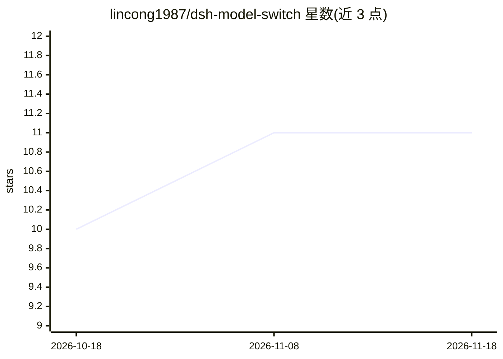

# lincong1987/dsh-model-switch

⭐ 11 · TypeScript · MIT · 推送 2026-10-23 · [GitHub](https://github.com/lincong1987/dsh-model-switch) · 个人维护 · 中文 README

**为 DeepSeek Harness 子代理与计划执行切换模型的插件**

DeepSeek Harness 的插件，让主会话、子代理与计划执行各自使用不同的模型而无需改动正常工作流：可保存默认模型配置、在计划审批面板中确认或更改执行模型、在子代理会话头部显示其模型/上下文窗口/推理力度，并在计划执行结束后恢复原主会话模型。通过 `dsh plugin` 命令从 GitHub 安装，未发布 npm 包；针对 DSH 0.2.0-rc.2 构建并声明兼容范围，DSH 升级后需用 `--force` 重装。

## 筛选速览

| 维度 | 判定 | 备注 |
|---|---|---|
| AI 角色 | `ai-ecosystem` | LLM/agent 周边工具 |
| 许可风险 | `permissive` | MIT |
| 部署形态 | `None` |  |
| 模型依赖 | — | README 未给出锁定关系 |
| 硬件要求 | — | 无带数字的原话,不猜 |
| 安装摩擦 | `low` | 无编译、无系统依赖或容器化 |
| 成熟度 | — | 结构信号不足 |

## 能力要点

- 主会话/子代理/计划执行分别配置模型
- 计划审批面板中确认或更改执行模型
- 子代理会话头部显示模型、上下文窗口与推理力度
- 计划执行后自动恢复主会话原模型

## 适用场景

- 主对话保留偏好模型，同时给子代理分配别的模型
- 保存默认配置，免去每次任务前手动切换
- 执行计划前在审批面板确认所用模型

## 场景标签

 · 领域:开发者工具/Agent 框架插件

## 证据(README 行号)

> L5: Use the right model for each stage of work in DeepSeek Harness.
> L7: The main conversation, subagents, and plan execution serve different purposes. `dsh-model-switch` lets each of them 
> L87: Built and typechecked against DeepSeek Harness **0.2.0-rc.2** (peer range `^0.2.0-rc.2`). Settings are the plugin e

## 星数曲线

2026-10-18 10 → 2026-11-18 11（+1）

---
*卡片 v1 · prompt 1.4 · 生成 2026-11-18 · 置信度 high · 依据 README sha `4723f4dea551` · [字段定义](../../DATASET.md)*
