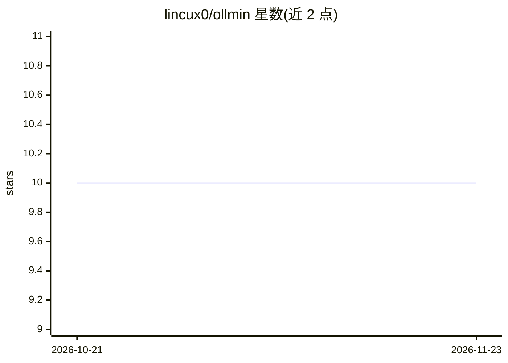

# lincux0/ollmin

⭐ 10 · Rust · MIT · 推送 2026-11-04 · [GitHub](https://github.com/lincux0/ollmin) · 个人维护 · 中文 README

**面向低端 PC 的轻量 Ollama 桌面客户端**

基于 Tauri 的 Windows 桌面应用，作为本机 Ollama 服务的聊天客户端运行：连接 127.0.0.1:11434，针对 CPU、集成显卡与 3B/4B 级小模型设计。提供 Fast/Balanced/Reasoning 三种请求配置模式、本地 PDF/DOCX/XLS/XLSX 解析与有限摘录注入、SQLite 本地会话历史与导出。单请求执行、无遥测、无账号；安装版无需 Node.js/Rust，也提供源码构建路径。

## 筛选速览

| 维度 | 判定 | 备注 |
|---|---|---|
| AI 角色 | `ai-ecosystem` | LLM/agent 周边工具 |
| 许可风险 | `permissive` | MIT |
| 部署形态 | `None` |  |
| 模型依赖 | local-ok | 支持本地模型 |
| 硬件要求 | — | 无带数字的原话,不猜 |
| 安装摩擦 | `low` | 无编译、无系统依赖或容器化 |
| 成熟度 | — | 结构信号不足 |

## 能力要点

- 连接本机 Ollama（127.0.0.1:11434），面向小模型与低端硬件
- Fast/Balanced/Reasoning 三种 Ollama 请求配置模式（上下文与输出上限）
- 本地解析 PDF/DOCX/XLS/XLSX，仅发送有限相关摘录
- SQLite 本地会话历史，支持搜索/重命名/导出

## 适用场景

- 在没有独立显卡的日常 PC 上运行本地大模型对话
- 离线环境下提问本地文档（PDF/DOCX/表格）
- 需要无账号、无遥测的本地隐私聊天界面

## 场景标签

`聊天机器人` `文档问答` `文档解析` · 领域:对话与助手

## 证据(README 行号)

> L5:  A fast Ollama desktop client optimized for CPUs, integrated graphics, and small local models.
> L33: - Local model support: Ollmin connects to Ollama on your own PC; downloaded local models need no account;

## 星数曲线

2026-10-21 10 → 2026-11-23 10（+0）

---
*卡片 v1 · prompt 1.4 · 生成 2026-11-19 · 置信度 high · 依据 README sha `bf5749304e70` · [字段定义](../../DATASET.md)*
