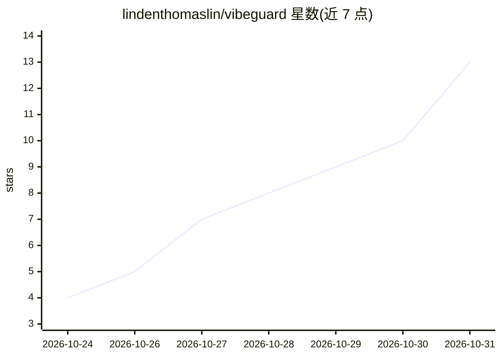

# lindenthomaslin/vibeguard

⭐ 13 · Rust · MIT · 推送 2026-10-24 · [GitHub](https://github.com/lindenthomaslin/vibeguard) · [官网](https://thomas-ai.space) · 个人维护 · 中文 README

**面向 AI 生成代码的终端安全审阅工具，先看 diff 再落盘**

Rust 编写的终端安全审阅工具，针对 AI 生成的代码项目：内置 410 条漏洞清单，先以 20 条本地规则做零 token 扫描（输出 file:line 与 CWE），再用模型（默认 DeepSeek，支持任意 OpenAI 兼容端点）逐条判定剩余项，证据（文件、行号、引文）核实后才成为发现。三种模式 plan/confirm/auto，默认只读，写文件前需确认；附 recall/precision 基准数据与覆盖率声明。经 npm、install.sh、cargo 或源码安装。

## 筛选速览

| 维度 | 判定 | 备注 |
|---|---|---|
| AI 角色 | `ai-native` | 本体是模型或模型工具 |
| 许可风险 | `permissive` | MIT |
| 部署形态 | `library` | 以包/库形式分发 |
| 模型依赖 | locked-api |  |
| 硬件要求 | — | 无带数字的原话,不猜 |
| 安装摩擦 | `medium` | 含编译或系统依赖之一 |
| 成熟度 | `idea` | |

## 能力要点

- 410 条漏洞清单 + 20 条本地规则零 token 扫描（file:line + CWE）
- 模型逐条判定并核实证据：文件存在、行号在范围内、原文引用，无法定位的单独列出
- plan/confirm/auto 三模式，默认只读，写盘前需按键确认，拒绝删除命令
- 附基准数据：本地规则 20/20，模型层 recall 15/15、precision 78.9%

## 适用场景

- AI 辅助编码项目的提交前安全自查
- 在 CI 或终端中对 vibe-coded 仓库生成带证据的漏洞报告
- 只读模式审阅不受信任的克隆仓库

## 场景标签

`代码审查` `网络安全` · 领域:编码与开发

## 证据(README 行号)

> L114: |`/scan --ai`|a handful of requests|the model judges the remaining security items, each with a verdict and evidenc
> L122: - Evidence is verified before it becomes a finding: the file must exist, the line must be in
> L137: The model tier has its own: `vibeguard bench` runs a small app with **15 planted vulnerabilities

## 星数曲线

2026-10-24 4 → 2026-10-31 13（+9）

---
*卡片 v1 · prompt 1.4 · 生成 2026-10-31 · 置信度 high · 依据 README sha `3cd8a9b515ff` · [字段定义](../../DATASET.md)*
