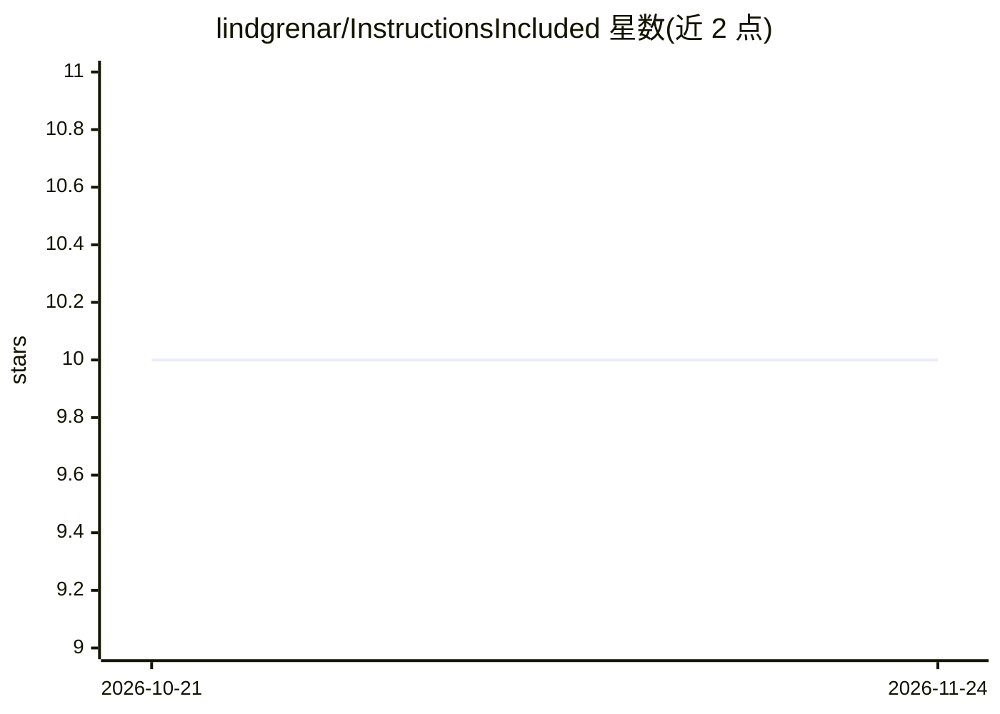

# lindgrenar/InstructionsIncluded

⭐ 10 · 推送 2026-02-09 · [GitHub](https://github.com/lindgrenar/InstructionsIncluded) · 个人维护

**面向 prompt 工程研究者的系统提示词提取集合**

收录从各模型中提取的系统提示词与运行指令的资料集合，每条条目要求注明具体模型与提取月份，通过 pull request 接受社区贡献。README 仅给出集合定位与贡献规范，未描述安装、运行方式或工具实现，属于提示词文本的策展知识库。

## 筛选速览

| 维度 | 判定 | 备注 |
|---|---|---|
| AI 角色 | `ai-knowledge` | 知识聚合/清单类 |
| 许可风险 | `none` | — |
| 部署形态 | `None` |  |
| 模型依赖 | — | README 未给出锁定关系 |
| 硬件要求 | — | 无带数字的原话,不猜 |
| 安装摩擦 | `low` | 无编译、无系统依赖或容器化 |
| 成熟度 | — | 结构信号不足 |

## 能力要点

- 按模型与提取月份组织的系统提示词条目
- 接受社区 pull request 贡献并要求标注提取时间

## 适用场景

- 查阅特定模型被提取出的系统提示词内容
- 研究 prompt injection / prompt extraction 相关语料

## 场景标签

`提示工程` `精选清单` · 领域:Agent 开发

## 证据(README 行号)

> L3: A collection of extracted system prompts and operational instructions.
> L5: Feel free to contribute! Send a pull request, including at minimum a specific model and the month of prompt extracti

## 星数曲线

2026-10-21 10 → 2026-11-24 10（+0）

---
*卡片 v1 · prompt 1.4 · 生成 2026-11-19 · 置信度 high · 依据 README sha `b8c1718bbe5a` · [字段定义](../../DATASET.md)*
