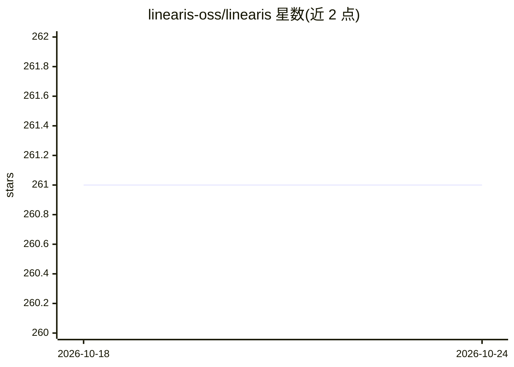

# linearis-oss/linearis

⭐ 261 · TypeScript · MIT · 推送 2026-10-24 · [GitHub](https://github.com/linearis-oss/linearis) · [官网](https://npmjs.com/package/linearis) · 组织维护

**面向 AI agent 的 Linear.app JSON CLI：省 token 地操作工单**

Linear 的命令行接口，仅输出 JSON，为 LLM agent 与偏好结构化数据的用户设计。核心机制是两层 usage 自描述发现系统（全局约 200 token、单域 300–500 token），使 agent 按需加载命令参考，典型交互约 500–700 token；支持人类可读 ID（如 ENG-42、团队名）到 UUID 的智能解析。覆盖 issues、projects、cycles、documents 等日常域，含讨论线程、文件附件、批量操作与 JSON Schema 校验。需 Node.js ≥22，经 npm 全局安装；不含自定义工作流与工作区设置（此类场景官方 MCP 更合适）。

## 筛选速览

| 维度 | 判定 | 备注 |
|---|---|---|
| AI 角色 | `ai-ecosystem` | LLM/agent 周边工具 |
| 许可风险 | `permissive` | MIT |
| 部署形态 | `library` | 以包/库形式分发 |
| 模型依赖 | — | README 未给出锁定关系 |
| 硬件要求 | — | 无带数字的原话,不猜 |
| 安装摩擦 | `low` | 无编译、无系统依赖或容器化 |
| 成熟度 | — | 结构信号不足 |

## 能力要点

- JSON-only 输出，可直接管道到 jq
- 两层 usage 发现系统，agent 按需加载命令参考
- 人类可读 ID（ENG-42/团队名）与 UUID 互换解析
- 批量创建/更新工单，附 JSON Schema（draft 2020-12）校验

## 适用场景

- 让 LLM agent 在低 token 开销下操作 Linear 工单
- 在脚本中用 jq 处理 Linear 结构化数据
- 批量创建或更新 issues/projects/cycles

## 场景标签

 · 领域:开发者工具/项目管理集成

## 证据(README 行号)

> L3: **A token-efficient Linear.app CLI built for AI agents — and humans who like structured data.**
> L11: Linearis is a command-line interface for Linear that speaks **JSON only**. It resolves human-friendly IDs (like `EN
> L21: The official Linear MCP works well, but it costs ~13k tokens just by being connected — before an agent does anythin

## 星数曲线

2026-10-18 261 → 2026-10-24 261（+0）

---
*卡片 v1 · prompt 1.4 · 生成 2026-10-22 · 置信度 high · 依据 README sha `1d83a08b3b0a` · [字段定义](../../DATASET.md)*
