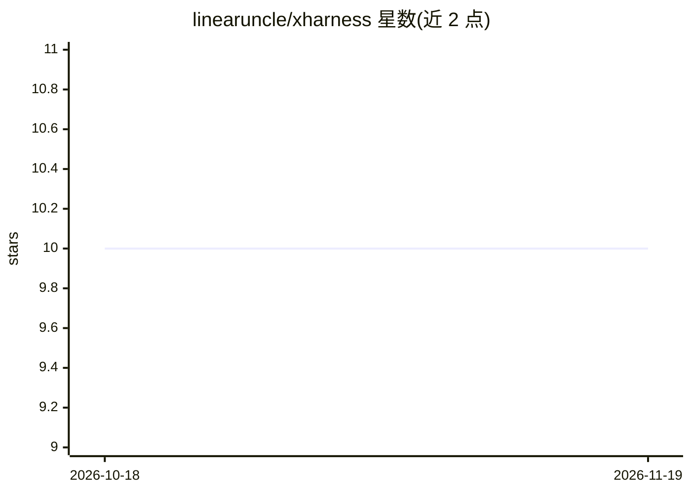

# linearuncle/xharness

⭐ 10 · TypeScript · MIT · 推送 2026-08-03 · [GitHub](https://github.com/linearuncle/xharness) · [官网](https://github.com/linearuncle/xharness/releases/latest) · 个人维护 · 中文 README

**macOS 上的 AI 编程搭档：聊天布置任务，自动读改代码并验证**

以 Electron 构建的 macOS GUI 应用并提供同引擎 CLI：用户把项目文件夹交给它，通过聊天布置任务，它读取代码、修改文件、执行命令验证并实时展示每一步。接入 Anthropic Messages 与 OpenAI Responses 两种 API 格式的模型服务（DeepSeek/Kimi/Anthropic/Grok 内置预置，可自定义供应商）。支持截图粘贴看图、SKILL.md 格式技能系统、AGENTS.md/CLAUDE.md 项目说明注入；数据存本地 SQLite。限制：仅发布 Apple Silicon 包，无沙箱，靠 AgentGuard 插件拦截高危删除命令。

## 筛选速览

| 维度 | 判定 | 备注 |
|---|---|---|
| AI 角色 | `ai-native` | 本体是模型或模型工具 |
| 许可风险 | `permissive` | MIT |
| 部署形态 | `library` | 以包/库形式分发 |
| 模型依赖 | locked-api |  |
| 硬件要求 | — | 无带数字的原话,不猜 |
| 安装摩擦 | `low` | 无编译、无系统依赖或容器化 |
| 成熟度 | — | 结构信号不足 |

## 能力要点

- 聊天布置任务，自动读代码、改代码、跑命令验证，全程实时可见
- 支持 Anthropic Messages 与 OpenAI Responses 两种 API 格式，可自定义供应商
- SKILL.md 技能系统（全局/项目级），兼容多家 AI 工具的通用目录约定
- AgentGuard 护栏插件拦截 rm/git clean/DROP 等高危删除操作，preToolUse hook 协议兼容 Claude Code/codex

## 适用场景

- 接手陌生代码库时让 AI 生成项目导览
- 布置修 bug 任务并让它跑到测试通过为止
- 粘贴设计稿截图让 AI 照图写页面
- 通过 SSH 场景用命令行版执行脚本化编码任务

## 场景标签

`编码 Agent` · 领域:编码与开发

## 证据(README 行号)

> L9: **一个装在你电脑上的 AI 编程搭档。** 把项目文件夹丢给它，用聊天的方式布置任务——它会自己读代码、改代码、跑命令验证，一步步做完，整个过程你都看得见。
> L67: xharness 支持两种 API 格式（供应商详情页的「API 格式」下拉可选）：**Anthropic

## 星数曲线

2026-10-18 10 → 2026-11-19 10（+0）

---
*卡片 v1 · prompt 1.4 · 生成 2026-11-19 · 置信度 high · 依据 README sha `9d8929ca596f` · [字段定义](../../DATASET.md)*
