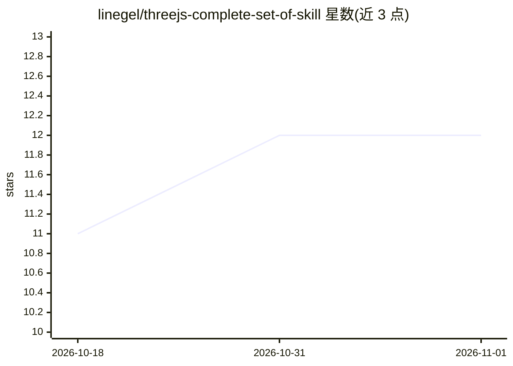

# linegel/threejs-complete-set-of-skill

⭐ 12 · JavaScript · ISC · 推送 2026-09-24 · [GitHub](https://github.com/linegel/threejs-complete-set-of-skill) · [官网](https://linegel.github.io/threejs-complete-set-of-skill/) · 个人维护

**面向 agent 的 Three.js WebGPU/TSL 技能包（27 个可安装技能）**

为 Claude Code、Codex、Cursor 等支持技能机制的 agent 提供的 27 个可安装 Three.js r185 WebGPU/TSL 技能（SKILL.md 格式），覆盖规划与验证、相机与最终成像、天空/云/海洋/水体等环境、程序化地形/材质/建筑/行星/植被、运动与特效等领域。通过 npx skills CLI 按需或整包安装，也可直接复制 skills/ 目录；每个技能由模型调用执行，附带脚本、示例与资源闭包，并用 npm run skills:check 校验产物边界与许可。

## 筛选速览

| 维度 | 判定 | 备注 |
|---|---|---|
| AI 角色 | `ai-knowledge` | 知识聚合/清单类 |
| 许可风险 | `permissive` | ISC |
| 部署形态 | `library` | 以包/库形式分发 |
| 模型依赖 | — | README 未给出锁定关系 |
| 硬件要求 | — | 无带数字的原话,不猜 |
| 安装摩擦 | `low` | 无编译、无系统依赖或容器化 |
| 成熟度 | — | 结构信号不足 |

## 能力要点

- 27 个按类别组织的 Three.js WebGPU/TSL agent 技能
- npx skills CLI 支持按需、整包及指定 agent 的非交互安装
- 含截图支撑的视觉验证与调试、兼容回退等验证类技能
- npm run skills:check 校验 roster、闭包与许可，禁止仓库内容泄漏进安装产物

## 适用场景

- 让 Claude Code/Codex 等 agent 按技能路由完成海洋、云、行星等程序化 Three.js 场景
- 为多渲染系统的需求选择最小技能集合（threejs-choose-skills）
- 对 Three.js 渲染结果做可证伪的视觉与性能验证

## 场景标签

`提示工程` · 领域:Agent 开发

## 证据(README 行号)

> L3: Twenty-seven installable agent skills for Three.js r185 WebGPU/TSL work. They cover
> L30: The authoritative installable product is `skills/`. Runtimes without

## 星数曲线

2026-10-18 11 → 2026-11-01 12（+1）

---
*卡片 v1 · prompt 1.4 · 生成 2026-11-01 · 置信度 high · 依据 README sha `65aac49f8268` · [字段定义](../../DATASET.md)*
