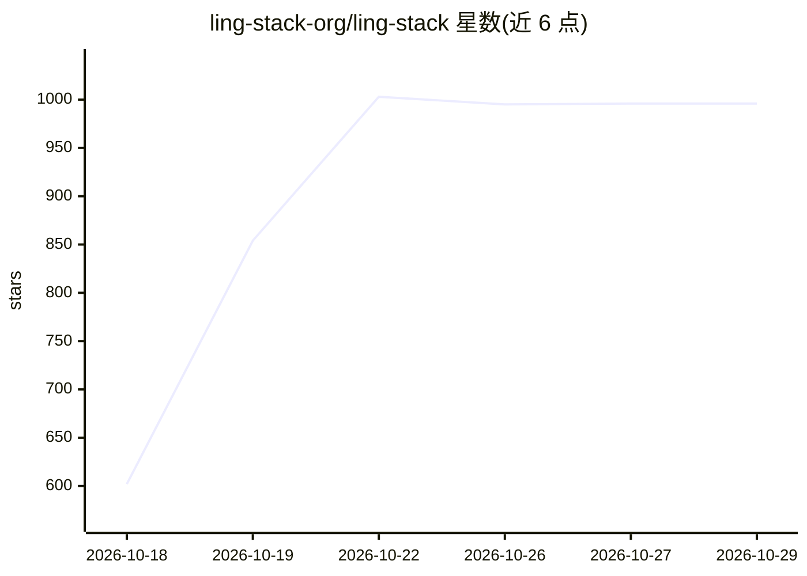

# ling-stack-org/ling-stack

⭐ 996 · TypeScript · MIT · 推送 2026-10-28 · [GitHub](https://github.com/ling-stack-org/ling-stack) · 组织维护 · 中文 README

**本地优先的 AI 队友协作工作区：多模型对话与工具审批集中管理**

面向需要同时使用多个 AI 模型或队友的开发者：通过共享的 Model Workbench 接入 OpenAI、Anthropic、Volcengine Ark、DeepSeek 兼容端点、MiniMax、GLM 及 OpenAI 兼容中继，在项目频道中集中管理对话、模型选择、工具绑定、审批请求与产出物。工作区状态与密钥存储在本地 .ling-stack/ 目录。支持 MCP 工具管理、图像/视频生成通道与 Electron 桌面开发壳。当前为 source alpha：需从源码构建运行（Node.js 22.22.1+、pnpm 10），稳定的签名安装包尚未提供，维护为尽力而为模式。

## 筛选速览

| 维度 | 判定 | 备注 |
|---|---|---|
| AI 角色 | `ai-ecosystem` | LLM/agent 周边工具 |
| 许可风险 | `permissive` | MIT |
| 部署形态 | `library` | 以包/库形式分发 |
| 模型依赖 | locked-api |  |
| 硬件要求 | — | 无带数字的原话,不猜 |
| 安装摩擦 | `medium` | 含编译或系统依赖之一 |
| 成熟度 | `idea` | |

## 能力要点

- Model Workbench 接入 OpenAI/Anthropic/Volcengine Ark/MiniMax/GLM 等多提供商
- 本地存储工作区状态、会话历史与运行证据（.ling-stack/）
- MCP 与插件管理器提供显式工具分配与审批边界
- Web、daemon、CLI 共享同一 daemon，另有 Electron 桌面开发壳与 CLI 诊断命令

## 适用场景

- 把多个模型和 AI 队友的对话、工具请求与结果集中到一个项目工作区
- 在本地管理工作区数据与 API 密钥，控制工具权限与付费生成审批
- 尝试文档评审等双队友协作任务并保留完整运行证据

## 场景标签

`多智能体` · 领域:Agent 开发

## 证据(README 行号)

> L31: can end up in separate windows. Ling Stack brings that work into a project channel:
> L49: and want to keep their work in one place. It connects OpenAI, Anthropic, Volcengine Ark,
> L113: Open **Settings → Model Workbench**, add a chat-capable model with your own API key,

## 星数曲线

2026-10-18 602 → 2026-10-29 996（+394）

---
*卡片 v1 · prompt 1.4 · 生成 2026-10-21 · 置信度 mid · 依据 README sha `682632696c82` · [字段定义](../../DATASET.md)*
