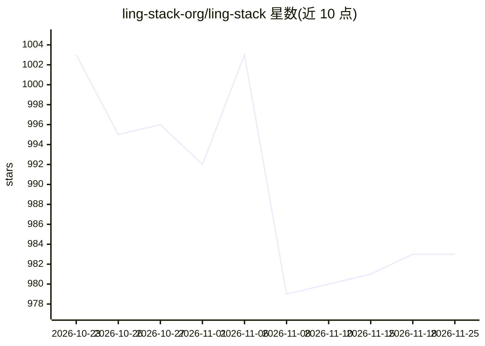

# ling-stack-org/ling-stack

⭐ 983 · TypeScript · MIT · 推送 2026-11-24 · [GitHub](https://github.com/ling-stack-org/ling-stack) · 组织维护 · 中文 README

**本地优先的 AI 队友工作区：多模型接入与工具审批集中管理**

一个本地优先的工作区应用，用户自带模型 API key，把项目对话、AI 队友分配、工具审批与产物保存在同一空间。通过 Model Workbench 接入 OpenAI、Anthropic、火山方舟、DeepSeek 兼容端点、MiniMax、GLM 及 OpenAI 兼容中转；支持聊天、AI 队友协作和图像/视频生成三种用法，并提供 MCP/插件管理的工具授权边界。数据（SQLite、会话、产物）存于本地。当前为 source-first alpha：Web/daemon/CLI 为默认路径，桌面构建为开发预览，需 Node.js 22、pnpm 10、Rust 1.89 从源码构建。

## 筛选速览

| 维度 | 判定 | 备注 |
|---|---|---|
| AI 角色 | `ai-ecosystem` | LLM/agent 周边工具 |
| 许可风险 | `permissive` | MIT |
| 部署形态 | `library` | 以包/库形式分发 |
| 模型依赖 | — | README 未给出锁定关系 |
| 硬件要求 | — | 无带数字的原话,不猜 |
| 安装摩擦 | `medium` | 含编译或系统依赖之一 |
| 成熟度 | `idea` | |

## 能力要点

- Model Workbench 统一接入多家模型服务商与 OpenAI 兼容中转
- 项目频道内分配 AI 队友的模型与工具，审批请求显式确认
- 工作区状态、会话历史与运行证据存于本地（SQLite）
- 接口提供 55 种语言/地区选项，界面与 AI 回复语言可分别配置

## 适用场景

- 把多个 AI 模型的对话和项目产出集中在一个本地工作区
- 给 AI 队友分配工具并在执行前逐项审批
- 在项目频道里做需求评审、验收评审并生成决策摘要
- 用自有 API key 配置模型后生成图像或视频素材

## 场景标签

`多智能体` `AI 助手` `图像生成` `视频生成` · 领域:Agent 开发

## 证据(README 行号)

> L63: and want to keep their work in one place. It connects OpenAI, Anthropic, Volcengine Ark,
> L77: - **Work with AI teammates.** Assign models and tools in a project channel.
> L67: Workspace state, conversation history, and run evidence are stored locally. Requests

## 星数曲线

2026-10-23 1,003 → 2026-11-25 983（-20）

---
*卡片 v1 · prompt 1.4 · 生成 2026-11-25 · 置信度 high · 依据 README sha `22dbf51faf14` · [字段定义](../../DATASET.md)*
