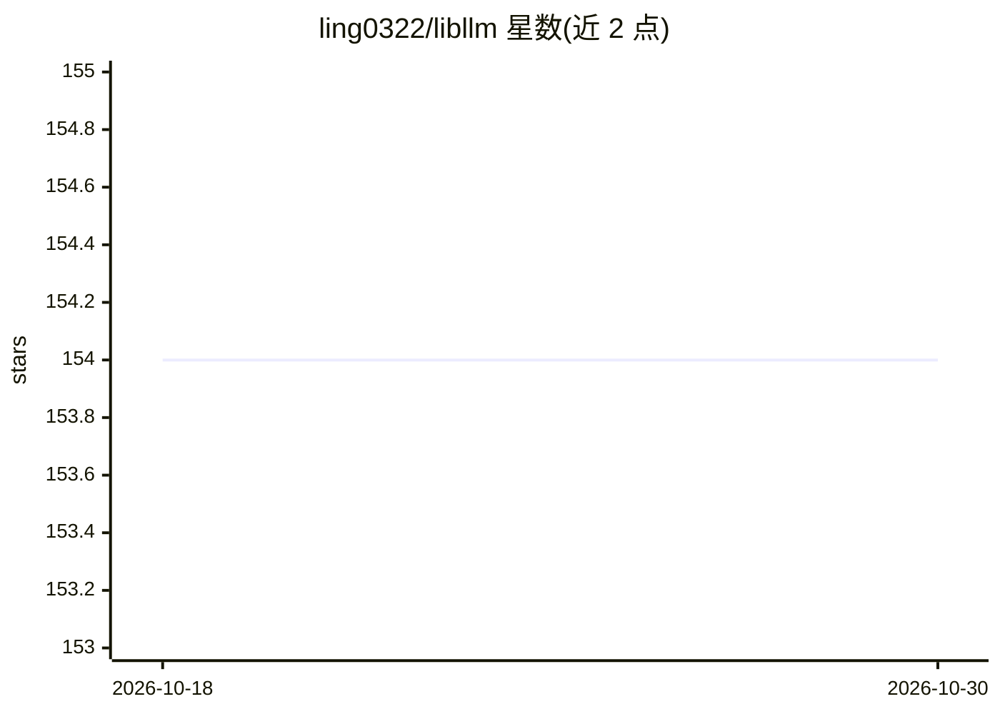

# ling0322/libllm

⭐ 154 · C++ · MIT · 推送 2026-08-28 · [GitHub](https://github.com/ling0322/libllm) · 个人维护

**Rust 实现的轻量级 LLM 推理引擎，提供 vLLM 式服务特性**

以 Rust 运行时配合 C++17/CUDA 内核的 LLM 推理引擎，提供连续批处理、分页 KV 缓存、分块预填充、请求抢占与逐请求采样等 vLLM 式服务特性。提供 llm 命令行（自动从 HuggingFace 下载模型并启动聊天 CLI）与 Rust API（Engine 回调流式生成）。支持 Linux/Windows x64 的 CUDA/AVX2/AVX512 后端与 macOS arm64 的 asimdhp 后端。需从源码构建：CMake 3.22+、C++17 编译器、Rust/Cargo、OpenMP，CUDA 构建需 CUDA Toolkit（可选 FlashAttention），macOS 需 brew 安装 libomp。

## 筛选速览

| 维度 | 判定 | 备注 |
|---|---|---|
| AI 角色 | `ai-ecosystem` | LLM/agent 周边工具 |
| 许可风险 | `permissive` | MIT |
| 部署形态 | `None` |  |
| 模型依赖 | — | README 未给出锁定关系 |
| 硬件要求 | — | 无带数字的原话,不猜 |
| 安装摩擦 | `high` | 编译与系统依赖俱全 |
| 成熟度 | — | 结构信号不足 |

## 能力要点

- 连续批处理、分页 KV 缓存、分块预填充、请求抢占与逐请求采样
- llm 命令行自动从 HuggingFace 下载模型并启动聊天 CLI
- Rust API 通过 Engine 回调流式生成文本
- CUDA 与 CPU（AVX2/AVX512/asimdhp）多后端内核支持矩阵

## 适用场景

- 在自有环境从源码构建并运行 Llama 3.2 等模型的推理与聊天
- 在 Rust 应用中嵌入 LLM 推理并以流式回调获取生成文本
- 需要 paged KV cache 与连续批处理等 vLLM 式特性的本地部署

## 场景标签

`推理引擎` · 领域:训练与推理

## 证据(README 行号)

> L3: libLLM is a lightweight LLM inference engine with a Rust runtime and optimized C++17/CUDA kernels. It provides vLLM-
> L67: CMake drives the whole build. Configuring picks the native Flint C++/CUDA options -- which

## 星数曲线

2026-10-18 154 → 2026-10-30 154（+0）

---
*卡片 v1 · prompt 1.4 · 生成 2026-10-22 · 置信度 high · 依据 README sha `a6becf18009d` · [字段定义](../../DATASET.md)*
