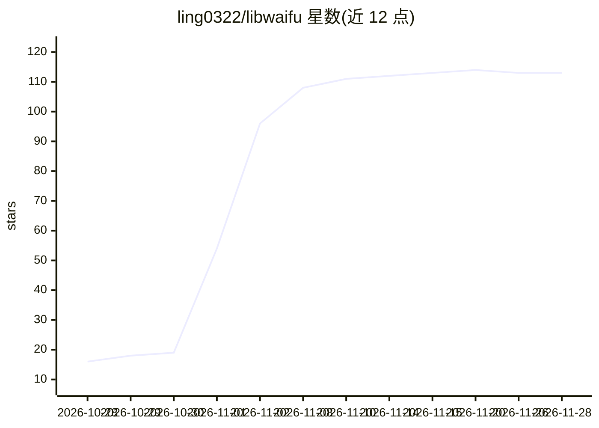

# ling0322/libwaifu

⭐ 113 · Rust · MIT · 推送 2026-11-16 · [GitHub](https://github.com/ling0322/libwaifu) · 个人维护

**本地 GPU 上的 AI 图像生成与语音推理库**

Rust + C++ 编写的本地推理库：输入提示词生成图片（SDXL/Anima/Krea 2/Qwen-Image 四个架构、多种微调与 FP8 量化版本），并通过 C API 与 macOS 应用提供 IndexTTS/CosyVoice 语音合成、变声、Qwen3-ASR 语音识别及插画分层导出 PSD。支持 CUDA/Metal/Vulkan/CPU 多后端与低显存模式（超显卡容量的模型仍可运行）。终端交互选模型出图，模型经清单按名拉取到本地缓存；MIT 许可。

## 筛选速览

| 维度 | 判定 | 备注 |
|---|---|---|
| AI 角色 | `ai-native` | 本体是模型或模型工具 |
| 许可风险 | `permissive` | MIT |
| 部署形态 | `desktop` | 安装包/桌面程序 |
| 模型依赖 | — | README 未给出锁定关系 |
| 硬件要求 | — | 无带数字的原话,不猜 |
| 安装摩擦 | `high` | 编译与系统依赖俱全 |
| 成熟度 | — | 结构信号不足 |

## 能力要点

- 四个图像生成架构（SDXL/Anima/Krea 2/Qwen-Image），含 FP8 量化版本
- 语音合成（IndexTTS 2.5/CosyVoice3）、变声、ASR（30 种语言）与 40ms 逐帧口型输出
- CUDA/Metal/Vulkan/CPU 自动选择后端，低显存模式支持超容量模型
- Rust API 与 C API 双接口，See-through 分层导出深度排序 PSD

## 适用场景

- 无 API key 在本地 GPU 上以提示词生成插画图像
- 本地文本转语音并驱动虚拟形象口型
- 为插画拆分头发/五官/服装等图层导出 PSD
- 本地录音转写与变声处理

## 场景标签

`图像生成` `语音合成` `语音识别` `图像视频处理` · 领域:内容生成

## 证据(README 行号)

> L5: libwaifu is an image generator that runs start to finish on your own machine. A prompt in, a
> L78: `-device cuda`, `-device vulkan` and `-device metal` keep as many of the model's weights on the
> L169: |OS|Platform|CUDA|Metal|Vulkan|avx2|avx512|asimdhp|asimdfhm|

## 星数曲线

2026-10-28 16 → 2026-11-28 113（+97）

---
*卡片 v1 · prompt 1.4 · 生成 2026-11-28 · 置信度 high · 依据 README sha `baafa52f28b2` · [字段定义](../../DATASET.md)*
