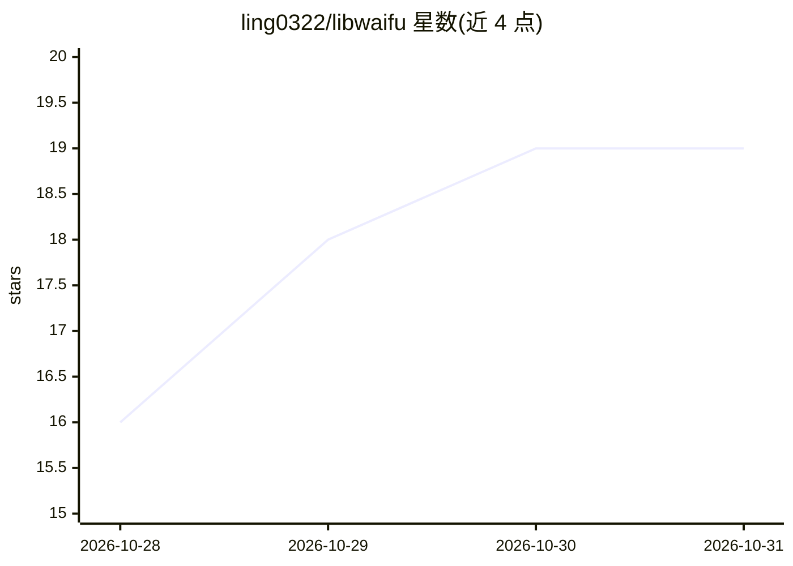

# ling0322/libwaifu

⭐ 19 · Rust · MIT · 推送 2026-10-29 · [GitHub](https://github.com/ling0322/libwaifu) · 个人维护

**本地 GPU 文生图与语音库：SDXL/Qwen-Image 出图，IndexTTS/CosyVoice 语音**

Rust + C++ 实现的本地推理库与终端程序：文生图支持 SDXL、Anima、Krea 2、Qwen-Image 四种架构，语音支持 IndexTTS 2.5 与 Fun-CosyVoice3（含语音转换），通过 C API 供 macOS 应用调用。无需 API key，全部在本机运行；自动选设备（CUDA→Metal→Vulkan→CPU），低内存模式下权重按需换入换出，模型大于显存仍可出图。从源码用 CMake 构建，提供 Rust API 示例。

## 筛选速览

| 维度 | 判定 | 备注 |
|---|---|---|
| AI 角色 | `ai-native` | 本体是模型或模型工具 |
| 许可风险 | `permissive` | MIT |
| 部署形态 | `desktop` | 安装包/桌面程序 |
| 模型依赖 | — | README 未给出锁定关系 |
| 硬件要求 | `cpu-ok` | |
| 安装摩擦 | `high` | 编译与系统依赖俱全 |
| 成熟度 | — | 结构信号不足 |

## 能力要点

- 四种文生图架构（SDXL/Anima/Krea 2/Qwen-Image）本地推理
- IndexTTS 2.5 与 Fun-CosyVoice3 文本转语音及语音转换，经 C API 提供
- CUDA/Metal/Vulkan/CPU 多后端，自动选择设备
- 低内存模式：权重超出显存时按需换入换出，模型大于显卡仍可出图

## 适用场景

- 在自有 GPU 上离线生成图片，不经过云服务
- 用自己的录音克隆声音做文本转语音或语音转换
- 作为 Rust 库或 C API 嵌入其他应用做本地图像/语音生成

## 场景标签

`图像生成` `语音合成` · 领域:内容生成

## 证据(README 行号)

> L5: libwaifu is an image generator that runs start to finish on your own machine. A prompt in, a
> L6: picture out -- SDXL, Anima, Krea 2 or Qwen-Image, painted by the GPU you already have, as fast as the
> L128: |OS|Platform|CUDA|Metal|Vulkan|avx2|avx512|asimdhp|asimdfhm|

## 星数曲线

2026-10-28 16 → 2026-10-31 19（+3）

---
*卡片 v1 · prompt 1.4 · 生成 2026-10-29 · 置信度 high · 依据 README sha `c6bd7f4fb545` · [字段定义](../../DATASET.md)*
